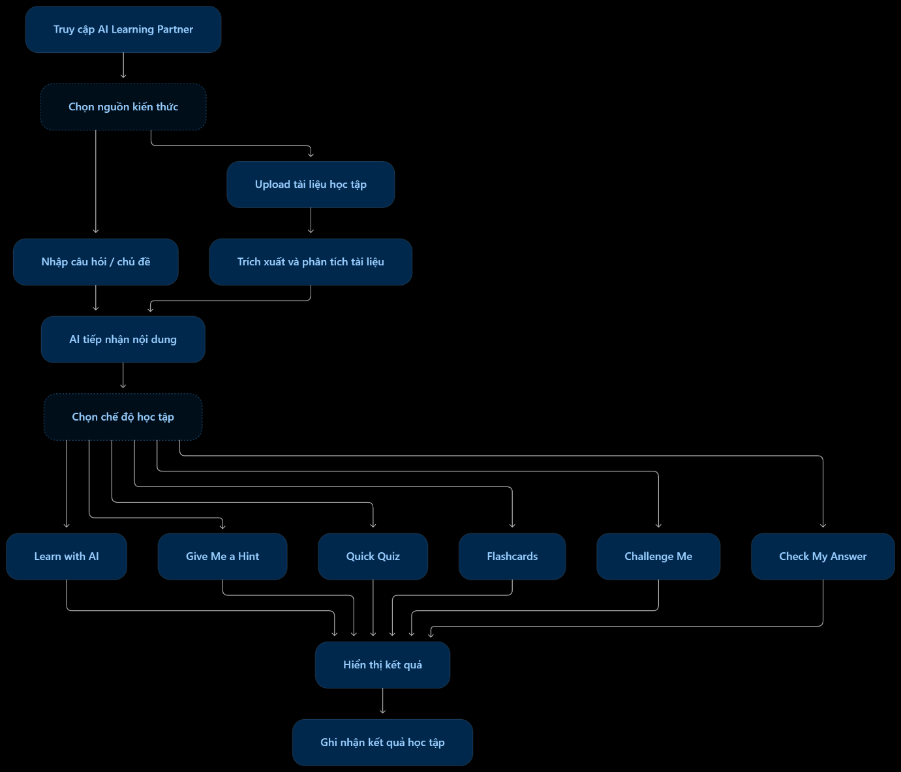

# FEATURE 01: AI Learning Partner – Người bạn đồng hành học tập AI

> **Core Feature**  
> **AI-powered**

## 1. Overview – Tổng quan

**Mục đích:**

Cung cấp một trợ lý học tập sử dụng AI, giúp học sinh tìm hiểu kiến thức, giải đáp thắc mắc, luyện tập và kiểm tra mức độ hiểu bài thông qua nhiều phương thức học tập khác nhau.

**Vấn đề cần giải quyết:**
- Học sinh gặp khó khăn khi tự học và không có người giải đáp thắc mắc ngay lập tức.
- Học sinh chưa hiểu sâu kiến thức khi chỉ đọc tài liệu hoặc xem bài giảng.
- Học sinh gặp khó khăn khi giải bài tập nhưng không biết cách tìm hướng giải quyết.
- Học sinh thiếu phương pháp ôn tập và kiểm tra mức độ ghi nhớ kiến thức.

**Đối tượng sử dụng:**
- Học sinh trung học cơ sở.
- Học sinh trung học phổ thông.

**Giá trị mang lại:**
- Hỗ trợ học sinh chủ động tìm hiểu kiến thức.
- Cá nhân hóa cách giải thích phù hợp với cấp học.
- Khuyến khích học sinh tự suy nghĩ và tìm ra lời giải thay vì phụ thuộc vào đáp án có sẵn.
- Giúp học sinh ghi nhớ kiến thức và nhận biết những nội dung chưa nắm vững.

## 2. Sub-features – Các chức năng nhỏ

AI Learning Partner gồm **8 chức năng nhỏ**:

| ID | Sub-feature | Mô tả |
|---|---|---|
| ALP-01 | Enter Question / Topic | Nhập câu hỏi hoặc chủ đề muốn tìm hiểu |
| ALP-02 | Upload Study Materials | Tải tài liệu học tập lên hệ thống |
| ALP-03 | Learn with AI | Học và giải thích kiến thức cùng AI |
| ALP-04 | Give Me a Hint | Nhận gợi ý khi gặp khó khăn |
| ALP-05 | Quick Quiz | Tạo bài kiểm tra nhanh |
| ALP-06 | Flashcards | Tạo thẻ ghi nhớ |
| ALP-07 | Challenge Me | Thử thách kiến thức |
| ALP-08 | Check My Answer | Chấm bài và giải thích lỗi sai |

## 3. User Flow – Luồng hoạt động

**Luồng tổng quát:**

1. Học sinh truy cập tính năng AI Learning Partner.
2. Học sinh lựa chọn một trong hai cách cung cấp nội dung:
   - Nhập câu hỏi hoặc chủ đề muốn tìm hiểu.
   - Tải tài liệu học tập lên hệ thống.
3. Hệ thống tiếp nhận và xử lý nội dung.
4. Học sinh lựa chọn chế độ học tập:
   - Learn with AI.
   - Give Me a Hint.
   - Quick Quiz.
   - Flashcards.
   - Challenge Me.
   - Check My Answer.
5. AI thực hiện xử lý theo chế độ được chọn.
6. Hệ thống hiển thị nội dung hoặc kết quả tương ứng.
7. Học sinh tiếp tục học, luyện tập hoặc kiểm tra kiến thức.
8. Hệ thống ghi nhận những kiến thức học sinh thường mắc lỗi để hỗ trợ ôn tập.

**Sơ đồ luồng tổng quát:**

**Tài liệu tham khảo giao diện:** MindKoi — AI Study Companion by Margo Semenova trên Dribbble.

## 4. Functional Description – Mô tả chức năng

### ALP-01: Enter Question / Topic – Nhập câu hỏi hoặc chủ đề

**Mô tả:**

Cho phép học sinh nhập trực tiếp câu hỏi, kiến thức hoặc chủ đề muốn tìm hiểu. Hệ thống tiếp nhận nội dung và chuyển đến AI xử lý theo chế độ học tập được lựa chọn. Học sinh có thể tiếp tục đặt câu hỏi để trao đổi với AI.

**Input:**
- Nội dung câu hỏi.
- Tên chủ đề hoặc kiến thức muốn tìm hiểu.

**Processing:**
1. Hệ thống tiếp nhận nội dung học sinh nhập.
2. Kiểm tra nội dung đầu vào.
3. Chuyển nội dung đến Backend.
4. Backend gửi yêu cầu đến Gemini Flash API.
5. AI xử lý nội dung theo chế độ học tập được lựa chọn.

**Output:**
- Nội dung phản hồi từ AI.
- Kết quả giải thích hoặc hỗ trợ học tập.

**Business Rules:**
- Học sinh phải nhập nội dung trước khi gửi câu hỏi.
- Nội dung được sử dụng làm đầu vào cho chế độ học tập tương ứng.
- Học sinh có thể tiếp tục đặt câu hỏi trong quá trình trao đổi.

**Exception Handling:**
- Câu hỏi bị bỏ trống → yêu cầu nhập nội dung.
- Nội dung không rõ ràng → yêu cầu học sinh diễn đạt lại.
- AI không phản hồi → hiển thị thông báo và cho phép thử lại.

**AI sử dụng:** Backend + Gemini Flash API

### ALP-02: Upload Study Materials – Tải tài liệu học tập

**Mô tả:**

Cho phép học sinh tải tài liệu học tập dưới dạng PDF, DOCX hoặc hình ảnh ghi chép. Hệ thống trích xuất văn bản và sử dụng AI phân tích nội dung, xác định các chủ đề và khái niệm quan trọng để phục vụ các chế độ học tập.

**Input:**
- File PDF.
- File DOCX.
- Hình ảnh ghi chép.

**Processing:**
1. Học sinh lựa chọn tài liệu cần tải lên.
2. Hệ thống kiểm tra định dạng file.
3. Sử dụng thư viện đọc file để trích xuất văn bản từ PDF/DOCX.
4. Sử dụng OCR để nhận diện văn bản từ hình ảnh khi cần.
5. Gửi nội dung trích xuất đến Gemini Flash API.
6. AI phân tích và xác định chủ đề, nội dung và khái niệm quan trọng.
7. Hệ thống lưu kết quả xử lý để sử dụng trong các chế độ học tập.

**Output:**
- Nội dung văn bản đã trích xuất.
- Danh sách chủ đề và kiến thức quan trọng.
- Nguồn nội dung sẵn sàng cho các chế độ học tập.

**Business Rules:**
- Chỉ chấp nhận các định dạng PDF, DOCX và hình ảnh được hỗ trợ.
- Nội dung sau khi trích xuất phải được kiểm tra trước khi sử dụng.
- Không sử dụng tài liệu không thể trích xuất nội dung.

**Exception Handling:**
- File không đúng định dạng → thông báo định dạng không được hỗ trợ.
- File bị lỗi hoặc không đọc được → yêu cầu tải lại.
- OCR không nhận diện được nội dung → thông báo không thể trích xuất văn bản.
- AI không phân tích được tài liệu → thông báo và cho phép thử lại.

**AI sử dụng:** PDF/DOCX Parser + OCR khi cần + Gemini Flash API

### ALP-03: Learn with AI – Học cùng AI

**Mô tả:**

Cho phép học sinh lựa chọn nội dung cần học từ câu hỏi hoặc tài liệu đã cung cấp. AI giải thích kiến thức bằng ngôn ngữ đơn giản, phù hợp với cấp học. Học sinh có thể yêu cầu AI đưa ra ví dụ minh họa hoặc giải thích lại những phần chưa hiểu.

**Input:**
- Câu hỏi hoặc chủ đề học tập.
- Nội dung được trích xuất từ tài liệu.
- Yêu cầu giải thích thêm hoặc ví dụ minh họa.

**Processing:**
1. Hệ thống tiếp nhận nội dung học sinh muốn tìm hiểu.
2. Gửi nội dung và yêu cầu đến Gemini Flash API.
3. AI phân tích kiến thức và tạo nội dung giải thích.
4. AI điều chỉnh cách diễn đạt phù hợp với cấp học.
5. Hệ thống hiển thị phản hồi cho học sinh.

**Output:**
- Nội dung giải thích kiến thức.
- Ví dụ minh họa.
- Nội dung giải thích lại theo yêu cầu.

**Business Rules:**
- Nội dung giải thích phải liên quan đến chủ đề học sinh yêu cầu.
- Ngôn ngữ giải thích cần phù hợp với cấp học.
- Học sinh được phép yêu cầu giải thích lại hoặc cung cấp ví dụ.

**Exception Handling:**
- Không có nội dung đầu vào → yêu cầu học sinh cung cấp câu hỏi hoặc chủ đề.
- AI không hiểu yêu cầu → đề nghị học sinh nhập lại.
- AI gặp lỗi xử lý → thông báo và cho phép thử lại.

**AI sử dụng:** Gemini Flash API

### ALP-04: Give Me a Hint – Gợi ý khi gặp khó khăn

**Mô tả:**

Cho phép học sinh lựa chọn một bài tập hoặc câu hỏi cần giải quyết. AI đưa ra gợi ý theo từng bước thay vì cung cấp đáp án ngay lập tức. Nếu học sinh vẫn gặp khó khăn, AI tiếp tục đưa ra gợi ý chi tiết hơn.

**Input:**
- Bài tập hoặc câu hỏi cần giải quyết.
- Yêu cầu nhận gợi ý của học sinh.

**Processing:**
1. Hệ thống tiếp nhận bài tập.
2. Gửi nội dung đến Gemini Flash API.
3. AI phân tích bài tập và xác định hướng giải quyết.
4. AI tạo gợi ý đầu tiên.
5. Nếu học sinh yêu cầu thêm, AI cung cấp gợi ý chi tiết hơn.

**Output:**
- Gợi ý giải quyết bài tập theo từng bước.
- Gợi ý bổ sung khi học sinh cần hỗ trợ thêm.

**Business Rules:**
- Không cung cấp ngay đáp án hoàn chỉnh ở gợi ý đầu tiên.
- Gợi ý phải liên quan đến bài tập.
- Các gợi ý tiếp theo cần chi tiết hơn gợi ý trước.

**Exception Handling:**
- Không có bài tập đầu vào → yêu cầu học sinh chọn bài tập.
- AI không xác định được hướng giải quyết → thông báo chưa thể tạo gợi ý.
- Lỗi kết nối AI → cho phép thử lại.

**AI sử dụng:** Gemini Flash API

### ALP-05: Quick Quiz – Tạo bài kiểm tra nhanh

**Mô tả:**

Cho phép học sinh lựa chọn chủ đề, số lượng câu hỏi và mức độ khó. AI tạo câu hỏi trắc nghiệm hoặc câu hỏi trả lời ngắn dựa trên nội dung đã cung cấp. Sau khi hoàn thành, hệ thống chấm điểm và hiển thị kết quả, đồng thời AI giải thích những câu trả lời sai.

**Input:**
- Chủ đề học tập.
- Số lượng câu hỏi.
- Mức độ khó.
- Nội dung tài liệu hoặc kiến thức đã cung cấp.

**Processing:**
1. Học sinh thiết lập các thông tin cho bài kiểm tra.
2. Hệ thống kiểm tra thông tin đầu vào.
3. Gửi yêu cầu đến Gemini Flash API.
4. AI tạo câu hỏi trắc nghiệm hoặc trả lời ngắn.
5. Học sinh thực hiện bài kiểm tra.
6. Hệ thống tiếp nhận câu trả lời và thực hiện chấm điểm.
7. AI giải thích những câu trả lời sai.

**Output:**
- Bộ câu hỏi kiểm tra.
- Kết quả bài kiểm tra.
- Điểm số và giải thích đáp án sai.

**Business Rules:**
- Phải có chủ đề học tập trước khi tạo bài kiểm tra.
- Số lượng câu hỏi phải là số hợp lệ.
- Câu hỏi phải liên quan đến nội dung học tập.
- Câu trả lời phải được ghi nhận trước khi chấm điểm.

**Exception Handling:**
- Thiếu thông tin thiết lập → yêu cầu bổ sung.
- Không tạo được câu hỏi → thông báo và cho phép tạo lại.
- Chưa hoàn thành bài kiểm tra → không hiển thị kết quả cuối cùng.
- Lỗi chấm điểm → thông báo và cho phép thực hiện lại.

**AI sử dụng:** Gemini Flash API

### ALP-06: Flashcards – Thẻ ghi nhớ

**Mô tả:**

Cho phép AI tạo các thẻ ghi nhớ gồm câu hỏi hoặc thuật ngữ ở mặt trước và câu trả lời hoặc giải thích ở mặt sau. Học sinh lật thẻ để kiểm tra khả năng ghi nhớ và đánh dấu những thẻ đã nhớ hoặc chưa nhớ để ưu tiên ôn tập lại.

**Input:**
- Chủ đề học tập.
- Nội dung tài liệu hoặc kiến thức đã cung cấp.

**Processing:**
1. Hệ thống tiếp nhận nội dung học tập.
2. Gửi yêu cầu đến Gemini Flash API.
3. AI xác định các khái niệm hoặc kiến thức quan trọng.
4. AI tạo các thẻ ghi nhớ gồm mặt trước và mặt sau.
5. Hệ thống hiển thị bộ flashcards.
6. Học sinh lật thẻ và đánh dấu trạng thái ghi nhớ.

**Output:**
- Bộ flashcards.
- Nội dung câu hỏi/thuật ngữ và câu trả lời/giải thích.
- Trạng thái đã nhớ hoặc chưa nhớ của từng thẻ.

**Business Rules:**
- Mỗi thẻ phải có nội dung ở mặt trước và mặt sau.
- Nội dung thẻ phải liên quan đến kiến thức được cung cấp.
- Học sinh có thể thay đổi trạng thái ghi nhớ.

**Exception Handling:**
- Không có nội dung đầu vào → yêu cầu cung cấp chủ đề hoặc tài liệu.
- AI không tạo được flashcards → thông báo và cho phép thử lại.
- Thẻ thiếu nội dung → không hiển thị thẻ không hợp lệ.

**AI sử dụng:** Gemini Flash API

### ALP-07: Challenge Me – Thử thách kiến thức

**Mô tả:**

Cho phép học sinh lựa chọn chủ đề và mức độ thử thách. AI tạo các bài tập từ dễ đến khó dựa trên nội dung học tập. Sau mỗi câu trả lời, hệ thống phản hồi kết quả và giải thích. Độ khó có thể tăng khi học sinh hoàn thành tốt các câu hỏi trước đó.

**Input:**
- Chủ đề học tập.
- Mức độ thử thách.
- Nội dung kiến thức đã cung cấp.
- Câu trả lời của học sinh.

**Processing:**
1. Học sinh lựa chọn chủ đề và mức độ thử thách.
2. Hệ thống gửi yêu cầu đến Gemini Flash API.
3. AI tạo các bài tập theo mức độ từ dễ đến khó.
4. Học sinh trả lời từng câu hỏi.
5. Hệ thống tiếp nhận và đánh giá câu trả lời.
6. AI tạo phản hồi và giải thích kết quả.
7. Nếu học sinh hoàn thành tốt các câu hỏi, hệ thống có thể yêu cầu AI tăng độ khó cho câu tiếp theo.

**Output:**
- Bộ câu hỏi thử thách.
- Kết quả đúng/sai sau mỗi câu.
- Giải thích đáp án.
- Câu hỏi có mức độ thử thách tiếp theo.

**Business Rules:**
- Câu hỏi phải phù hợp với chủ đề được chọn.
- Độ khó cần tăng dần theo khả năng làm bài.
- Phải có phản hồi sau mỗi câu trả lời.

**Exception Handling:**
- Không chọn chủ đề → yêu cầu học sinh chọn chủ đề.
- AI không tạo được câu hỏi → thông báo và cho phép thử lại.
- Không thể đánh giá câu trả lời → thông báo lỗi và cho phép gửi lại.

**AI sử dụng:** Gemini Flash API

### ALP-08: Check My Answer – Chấm bài và giải thích lỗi sai

**Mô tả:**

Cho phép học sinh nhập câu trả lời hoặc tải bài làm lên hệ thống. AI đánh giá câu trả lời dựa trên đáp án chuẩn hoặc tiêu chí chấm bài được cung cấp. Hệ thống hiển thị kết quả, chỉ ra lỗi sai và giải thích cách sửa.

**Input:**
- Câu trả lời do học sinh nhập.
- Hoặc file/hình ảnh bài làm.
- Đáp án chuẩn hoặc rubric chấm điểm.

**Processing:**
1. Học sinh nhập câu trả lời hoặc tải bài làm.
2. Hệ thống trích xuất nội dung nếu đầu vào là file/hình ảnh.
3. Gửi câu trả lời và đáp án chuẩn/rubric đến Gemini Flash API.
4. AI đánh giá câu trả lời dựa trên tiêu chí được cung cấp.
5. Xác định nội dung đúng, sai hoặc chưa đầy đủ.
6. Tạo phần giải thích và hướng dẫn sửa lỗi.
7. Hệ thống ghi nhận những kiến thức học sinh thường mắc lỗi để hỗ trợ ôn tập.

**Output:**
- Kết quả đánh giá câu trả lời.
- Điểm số hoặc mức độ hoàn thành.
- Nội dung sai và giải thích.
- Hướng dẫn sửa lỗi.
- Thông tin về kiến thức thường mắc lỗi.

**Business Rules:**
- Cần có nội dung bài làm để thực hiện đánh giá.
- Việc đánh giá phải dựa trên đáp án chuẩn hoặc rubric.
- Phải hiển thị giải thích cho những lỗi sai được xác định.
- Chỉ ghi nhận lỗi khi có đủ dữ liệu đánh giá.

**Exception Handling:**
- Không có câu trả lời → yêu cầu học sinh nhập hoặc tải bài làm.
- Không trích xuất được nội dung bài làm → yêu cầu tải lại.
- Thiếu đáp án chuẩn hoặc rubric → thông báo chưa đủ dữ liệu đánh giá.
- AI không thể đánh giá → thông báo và cho phép thử lại.

**AI sử dụng:** Gemini Flash API + đáp án chuẩn/rubric

## 5. Acceptance Criteria – Tiêu chí nghiệm thu

| ID | Tiêu chí nghiệm thu |
|---|---|
| AC-01 | Học sinh có thể nhập câu hỏi hoặc chủ đề để bắt đầu học. |
| AC-02 | Học sinh có thể tải lên PDF, DOCX và hình ảnh được hỗ trợ. |
| AC-03 | Hệ thống trích xuất và phân tích được nội dung tài liệu hợp lệ. |
| AC-04 | AI giải thích kiến thức và cung cấp ví dụ theo yêu cầu. |
| AC-05 | AI có thể đưa ra gợi ý theo từng bước. |
| AC-06 | Hệ thống tạo được bài kiểm tra theo chủ đề, số lượng và mức độ khó. |
| AC-07 | Hệ thống chấm điểm và giải thích câu trả lời sai. |
| AC-08 | Hệ thống tạo được flashcards và cho phép lật thẻ. |
| AC-09 | Học sinh có thể đánh dấu thẻ đã nhớ/chưa nhớ. |
| AC-10 | Hệ thống tạo được thử thách với độ khó phù hợp. |
| AC-11 | Hệ thống đánh giá bài làm dựa trên đáp án chuẩn hoặc rubric. |
| AC-12 | Hệ thống ghi nhận kiến thức học sinh thường mắc lỗi để hỗ trợ ôn tập. |

## 6. UI/UX Reference – Giao diện tham khảo

**Mô tả màn hình dự kiến:**
- AI Learning Partner Home: Các chế độ học tập để học sinh lựa chọn.
- AI Chat: Khu vực trao đổi và nhận giải thích từ AI.
- Upload Materials: Tải lên tài liệu học tập.
- Quick Quiz: Thiết lập và thực hiện bài kiểm tra.
- Flashcards: Hiển thị bộ thẻ ghi nhớ.
- Challenge: Thực hiện thử thách kiến thức.
- Answer Review: Xem kết quả và phân tích lỗi sai.

## 7. Priority – Mức độ ưu tiên

**Mức độ ưu tiên:** High

**Lý do:** Đây là một trong những tính năng cốt lõi của Study Pulse, trực tiếp hỗ trợ hoạt động học tập, giải đáp thắc mắc, luyện tập và cải thiện kiến thức của học sinh.

