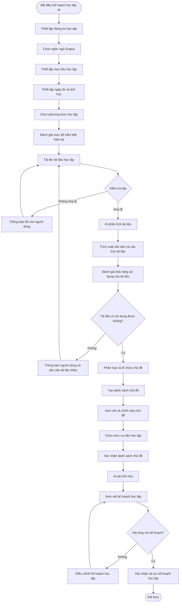

# AI STUDY PLANNER – KẾ HOẠCH HỌC TẬP CÁ NHÂN HÓA BẰNG AI

## 1. Tổng quan

### 1.1. Mục đích

Kế hoạch học tập AI là tính năng cho phép học sinh xây dựng kế hoạch học tập cá nhân hóa dựa trên thông tin học tập, mục tiêu, thời gian ôn tập, sở thích học tập và tài liệu do người dùng cung cấp.

Hệ thống ứng dụng AI để phân tích tài liệu học tập, trích xuất kiến thức, phân loại các chủ đề và xây dựng danh sách nội dung cần học. Sau khi học sinh kiểm tra và xác nhận danh sách chủ đề, AI tiếp tục sử dụng các thông tin đầu vào để tạo kế hoạch học tập phù hợp với năng lực và thời gian của từng học sinh.

### 1.2. Vấn đề cần giải quyết

- Học sinh có nhiều tài liệu học tập ở các định dạng khác nhau nhưng chưa có công cụ tổng hợp và tổ chức kiến thức hiệu quả.
- Học sinh gặp khó khăn trong việc xác định những kiến thức cần ưu tiên ôn tập.
- Học sinh chưa biết cách phân bổ thời gian học tập hợp lý trước các kỳ thi.
- Mỗi học sinh có trình độ, mục tiêu và phương pháp học tập khác nhau, nhưng thường phải sử dụng một kế hoạch học tập chung.
- Học sinh mất nhiều thời gian đọc, phân loại và tổng hợp nội dung từ các tài liệu.
- Học sinh khó xác định những kiến thức còn yếu và cần tập trung cải thiện.

### 1.3. Đối tượng sử dụng

| Đối tượng | Discribe |
| --------- | ----- |
| Học sinh  | Học sinh THCS và THPT sử dụng hệ thống để thiết lập và quản lý kế hoạch học tập cá nhân. |
| Phụ huynh | Phụ huynh có thể theo dõi kế hoạch và tiến độ học tập nếu hệ thống hỗ trợ vai trò này. |

### 1.4. Giá trị mang lại

**Đối với học sinh:**

- Tiết kiệm thời gian tổng hợp và phân loại tài liệu học tập.
- Có kế hoạch học tập phù hợp với mục tiêu cá nhân.
- Xác định được những chủ đề cần ưu tiên.
- Chủ động kiểm soát thời gian ôn tập trước kỳ thi.
- Tiếp cận nội dung học tập phù hợp với sở thích và mức độ hiểu biết.

---

# 2. Các chức năng nhỏ

Kế hoạch học tập AI được phân rã thành 5 nhóm nghiệp vụ chính và 14 chức năng nhỏ.

## 2.1. Thiết lập thông tin học tập

| ID | Chức năng nhỏ | Discribe nghiệp vụ |
| --- | --- | --- |
| ASP-01 | Thu thập thông tin học tập | Thu thập thông tin học tập cá nhân của người dùng. |
| ASP-02 | Lựa chọn ngôn ngữ Output | Lựa chọn ngôn ngữ sử dụng khi AI tạo nội dung học tập. |
| ASP-03 | Thiết lập mục tiêu học tập | Thiết lập mục tiêu học tập và kết quả mong muốn. |
| ASP-04 | Thiết lập ngày thi và lịch học | Thiết lập ngày thi và thời gian có thể dành cho việc học. |
| ASP-05 | Lựa chọn phương thức học tập | Lựa chọn phương thức học tập yêu thích. |
| ASP-06 | Đánh giá mức độ hiểu biết | Đánh giá mức độ hiểu biết hiện tại đối với môn học hoặc tài liệu ôn thi. |

## 2.2. Quản lý tài liệu học tập

| ID | Chức năng nhỏ | Discribe nghiệp vụ |
| --- | --- | --- |
| ASP-07 | Tải lên tài liệu học tập | Cho phép người dùng tải một hoặc nhiều tài liệu học tập lên hệ thống. |
| ASP-08 | Kiểm tra tệp | Kiểm tra định dạng, dung lượng, tính toàn vẹn và khả năng đọc của tài liệu. |

## 2.3. Processing tài liệu bằng AI

| ID | Chức năng nhỏ | Discribe nghiệp vụ |
| --- | --- | --- |
| ASP-09 | Phân tích tài liệu bằng AI | AI đọc, trích xuất, phân tích và đánh giá khả năng sử dụng của tài liệu. |

## 2.4. Quản lý chủ đề kiến thức

| ID | Chức năng nhỏ | Discribe nghiệp vụ |
| --- | --- | --- |
| ASP-10 | Phân loại và tổ chức chủ đề | Phân loại, nhóm và sắp xếp các chủ đề kiến thức theo cấu trúc logic. |
| ASP-11 | Tạo và xem xét danh sách chủ đề | Tạo danh sách chủ đề, cho phép người dùng xem xét, chỉnh sửa và xác nhận. |
| ASP-12 | Lựa chọn trọng tâm học tập | Cho phép người dùng lựa chọn những chủ đề cần ưu tiên tập trung. |

## 2.5. Tạo kế hoạch học tập bằng AI

| ID | Chức năng nhỏ | Discribe nghiệp vụ |
| --- | --- | --- |
| ASP-13 | Tạo lịch học bằng AI | AI phân bổ các chủ đề vào lịch học dựa trên mục tiêu, ngày thi và thời gian rảnh. |
| ASP-14 | Xem xét và lưu kế hoạch học tập | Cho phép người dùng xem xét, điều chỉnh, xác nhận và lưu kế hoạch học tập. |

# 3. Luồng hoạt động

## 3.1. Luồng tổng quát

Quy trình bắt đầu khi học sinh truy cập Kế hoạch học tập AI và cung cấp các thông tin cần thiết.
Hệ thống tiếp nhận dữ liệu, Processing tài liệu bằng AI, tổ chức danh sách chủ đề và cuối cùng tạo kế hoạch học tập cá nhân hóa.

### Luồng chính

1. Học sinh truy cập Kế hoạch học tập AI.
2. Hệ thống hiển thị quy trình thiết lập học tập.
3. Học sinh cung cấp thông tin học tập cá nhân.
4. Học sinh chọn ngôn ngữ Output.
5. Học sinh thiết lập mục tiêu học tập và điểm số mục tiêu.
6. Học sinh cấu hình ngày thi và thời gian có thể học.
7. Học sinh chọn phương thức học tập ưa thích.
8. Học sinh tự đánh giá mức độ hiểu biết hiện tại.
9. Học sinh tải lên tài liệu học tập.
10. Hệ thống kiểm tra các tệp đã tải lên.
11. AI đọc và phân tích các tài liệu hợp lệ.
12. AI trích xuất văn bản và nhận diện cấu trúc kiến thức.
13. AI đánh giá khả năng sử dụng của tài liệu.
14. AI nhận diện, phân loại và tổ chức các chủ đề học tập.
15. Hệ thống tạo danh sách chủ đề có cấu trúc.
16. Học sinh xem xét và chỉnh sửa danh sách chủ đề đã tạo.
17. Học sinh chọn những chủ đề cần dành nhiều sự chú ý nhất.
18. Học sinh xác nhận danh sách chủ đề.
19. AI phân tích toàn bộ thông tin học tập đã được xác nhận.
20. AI tạo lịch học cá nhân hóa.
21. Học sinh xem xét kế hoạch học tập đã được tạo.
22. Học sinh điều chỉnh kế hoạch nếu cần.
23. Học sinh xác nhận kế hoạch học tập.
24. Hệ thống lưu kế hoạch học tập.
25. Hệ thống cung cấp kế hoạch đã lưu cho các hoạt động học tập tiếp theo.

## 3.2. Sơ đồ luồng người dùng

## 3.3. Luồng thay thế

- Học sinh bỏ qua thông tin tùy chọn: Hệ thống tiếp tục sử dụng các thông tin hiện có nếu đáp ứng yêu cầu tối thiểu.
- Học sinh tải lên nhiều tệp: Hệ thống kiểm tra và Processing từng tệp một cách độc lập.
- Một số tệp không hợp lệ: Hệ thống chỉ ra các tệp không hợp lệ và cho phép học sinh thay thế hoặc xóa.
- AI không thể trích xuất nội dung: Hệ thống báo lỗi và cho phép tải lại hoặc thử lại.
- Học sinh chỉnh sửa danh sách chủ đề: AI sử dụng danh sách đã cập nhật cho các bước tạo kế hoạch học tập tiếp theo.
- Học sinh thay đổi mức ưu tiên học tập: AI cập nhật việc phân bổ thời gian học tương ứng.
- Học sinh không hài lòng với kế hoạch đã tạo: Học sinh có thể chỉnh sửa kế hoạch hoặc yêu cầu tạo lại.
- Học sinh thoát trước khi lưu: Hệ thống nên lưu giữ tiến trình nếu được hỗ trợ.

---

# 4. Discribe chức năng

## ASP-01. Thu thập thông tin học tập

**Discribe:**

Cho phép học sinh cung cấp các thông tin cá nhân và thông tin học tập cơ bản để hệ thống xác định đối tượng, nhu cầu và bối cảnh học tập của người dùng.

**Input:**

- Trình độ học vấn (THCS/THPT).
- Khối lớp.
- Độ tuổi
- Thông tin môn học.
- Ngôn ngữ mẹ đẻ
- Khó khăn khi học

**Processing:**

1. Hệ thống truy xuất hồ sơ hiện có của người dùng.
2. Hệ thống hiển thị các trường thông tin học tập bắt buộc.
3. Học sinh cung cấp hoặc cập nhật thông tin.
4. Hệ thống kiểm tra tính hợp lệ của thông tin.
5. Hệ thống liên kết thông tin với tài khoản của người dùng.

**Output:**

- Hồ sơ học tập đã cập nhật.
- Cấp học.
- Khối lớp.
- Trạng thái thông tin học tập.

**Business rule:**

| ID   | Business rule |
| ---- | ----------------- |
| BR01 | Xác thực người dùng: Chỉ người dùng đã đăng nhập mới được thiết lập thông tin học tập. |
| BR02 | Trình độ học vấn: Cấp học phải thuộc phạm vi hệ thống hỗ trợ. |
| BR03 | Kiểm tra khối lớp: Khối lớp phải phù hợp với cấp học. |
| BR04 | Liên kết hồ sơ: Thông tin phải được liên kết với đúng tài khoản người dùng. |
| BR05 | Cập nhật hồ sơ: Người dùng có thể cập nhật thông tin học tập khi cần. |

**Exception Handling:**

- Thiếu thông tin bắt buộc: Hệ thống yêu cầu người dùng cung cấp thông tin còn thiếu.
- Trình độ học vấn không hợp lệ: Hệ thống hiển thị thông báo kiểm tra.
- Khối lớp không hợp lệ: Hệ thống yêu cầu người dùng chọn khối lớp hợp lệ.
- Lỗi truy xuất hồ sơ: Hệ thống hiển thị lỗi và cho phép thử lại.
- Lỗi lưu dữ liệu: Hệ thống giữ lại thông tin đã nhập nếu có thể và cho phép thử lại.

---

## ASP-02. Lựa chọn ngôn ngữ đầu ra

**Discribe:**

Cho phép học sinh lựa chọn ngôn ngữ mà AI sẽ sử dụng để tạo nội dung học tập, giải thích kiến thức và các thông tin liên quan đến kế hoạch học tập.

**Input:**

- Ngôn ngữ đầu ra do người dùng chọn
- Tài liệu đã upload, môn học, loại bài tập cần tạo
- Ngôn ngữ giao diện app hoặc quốc gia đã chọn lúc thu thập thông tin học tập, dùng để gợi ý giá trị mặc định

**Processing:**

1. Hệ thống hiển thị các ngôn ngữ đầu ra được hỗ trợ.
2. Học sinh chọn ngôn ngữ mong muốn.
3. Hệ thống kiểm tra tính hợp lệ của ngôn ngữ đã chọn.
4. Hệ thống lưu lựa chọn ngôn ngữ.
5. AI nhận thiết lập ngôn ngữ cho các lần tạo nội dung tiếp theo.

**Output:**

- Ngôn ngữ Output đã chọn.
- Tùy chọn ngôn ngữ đã cập nhật.

**Business rule:**

| ID   | Business rule |
| ---- | ----------------- |
| BR01 | Chọn ngôn ngữ: Người dùng phải chọn một ngôn ngữ trong danh sách hệ thống hỗ trợ. |
| BR02 | Ngôn ngữ được hỗ trợ: Chỉ cho phép sử dụng ngôn ngữ được hệ thống hỗ trợ. |
| BR03 | Nhất quán ngôn ngữ: AI phải sử dụng ngôn ngữ đã chọn khi tạo nội dung. |
| BR04 | Cập nhật ngôn ngữ: Người dùng có thể thay đổi ngôn ngữ đầu ra. |
| BR05 | Lưu trữ ngôn ngữ: Lựa chọn phải được lưu và sử dụng trong các bước tiếp theo. |

**Exception Handling:**

- Ngôn ngữ không được hỗ trợ: Hệ thống từ chối lựa chọn.
- Chưa chọn ngôn ngữ: Hệ thống yêu cầu người dùng chọn ngôn ngữ hoặc thiết lập ngôn ngữ mặc định từ chức năng thu thập thông tin.
- Lỗi lưu dữ liệu: Hệ thống thông báo cho người dùng và cho phép thử lại.

---

## ASP-03. Thiết lập mục tiêu học tập

**Discribe:**

Cho phép học sinh thiết lập mục tiêu học tập để AI hiểu được kết quả mà người dùng mong muốn đạt được và sử dụng thông tin đó để xây dựng kế hoạch phù hợp.

**Input:**

- Mục tiêu học tập.
- Điểm số mục tiêu.
- Mô tả mục tiêu.
- Môn học.
- Ngày thi.
- Thời khoá biểu hiện tại.
- Thời gian tự học mỗi ngày.
- Dữ liệu từ chức năng thu thập thông tin học tập.

**Processing:**

1. Hệ thống hiển thị các tùy chọn mục tiêu học tập có sẵn.
2. Học sinh chọn hoặc nhập mục tiêu học tập.
3. Học sinh cung cấp điểm số mục tiêu nếu áp dụng.
4. Hệ thống kiểm tra tính hợp lệ của thông tin.
5. Hệ thống lưu mục tiêu học tập.
6. AI nhận mục tiêu làm dữ liệu đầu vào cho việc tạo kế hoạch học tập.

**Output:**

- Bộ mục tiêu học tập được lưu.
- Số ngày còn lại và tổng số giờ học khả dụng
- Mục tiêu được chuyển cho AI Study Planner để phân bổ chủ đề theo thời gian
- Trạng thái mục tiêu học tập (xác nhận lưu hoặc cảnh báo).

**Business rule:**

| ID   | Business rule |
| ---- | ----------------- |
| BR01 | Người dùng phải chọn ít nhất 1 môn học trước khi thiết lập mục tiêu |
| BR02 | Ngày thi phải lớn hơn ngày hiện tại |
| BR03 | Khoảng điểm mục tiêu: Điểm số mục tiêu phải nằm trong thang điểm được hệ thống cấu hình. |
| BR04 | Liên kết mục tiêu: Mục tiêu phải được liên kết với môn học hoặc kế hoạch tương ứng. |
| BR05 | Cập nhật mục tiêu: Người dùng có thể cập nhật mục tiêu trước khi xác nhận kế hoạch học tập. |
| BR06 | Tích hợp mục tiêu vào AI: AI phải sử dụng mục tiêu làm dữ liệu tham khảo khi tạo kế hoạch. |
| BR07 | Hệ thống tính số ngày còn lại từ ngày hiện tại đến ngày thi và dùng làm căn cứ phân bổ lộ trình. |

**Exception Handling:**

- Thiếu mục tiêu: Hệ thống yêu cầu người dùng cung cấp mục tiêu.
- Ngày thi là hôm nay hoặc đã qua: Báo lỗi, không cho phép chọn ngày quá hạn hôm nay, yêu cầu chọn lại.
- Điểm số mục tiêu không hợp lệ: Hệ thống hiển thị thông báo kiểm tra.
- Mục tiêu mâu thuẫn: Hệ thống yêu cầu làm rõ nếu các mục tiêu không thể đồng thời đạt được.
- Thời khóa biểu kín lịch, không còn giờ trống: Cảnh báo và đề nghị nhập lại thời gian rảnh
- Lỗi lưu dữ liệu: Hệ thống thông báo cho người dùng và cho phép thử lại.
- Người dùng chưa nhập thời khóa biểu: Dùng giá trị mặc định hoặc cho bỏ qua

---

## ASP-04. Thiết lập ngày thi và lịch học

**Discribe:**

Cho phép học sinh thiết lập ngày thi và thời gian có thể dành cho việc học để AI xác định khoảng thời gian ôn tập và phân bổ nội dung học tập hợp lý.

**Input:**

- Ngày thi.
- Các ngày có thể học.
- Lịch học trên trường
- Thời gian có thể học.
- Thời gian học ưa thích.
- Thời lượng mỗi buổi học.
- Múi giờ.
- Môn học và điểm mục tiêu từ tính năng thiết lập mục tiêu

**Processing:**

1. Hệ thống hiển thị phần cấu hình ngày thi và lịch học.
2. Học sinh chọn ngày thi, tải ảnh lịch học cá nhân để AI phân tích lịch học.
3. Học sinh cấu hình các ngày có thể học.
4. Hệ thống kiểm tra tính hợp lệ của lịch học.
5. Hệ thống tính toán khoảng thời gian ôn tập khả dụng.
6. Hệ thống lưu thông tin lịch học.

**Output:**

- Lịch học được lưu: ngày thi và các khung giờ tự học khả dụng
- Số ngày còn lại và tổng số giờ học khả dụng
- Quỹ thời gian được chuyển cho AI để phân bổ chủ đề theo ngày/tuần
- Các ngày có thể học.
- Thời gian có thể học.
- Xác nhận lưu hoặc cảnh báo

**Business rule:**

| ID   | Business rule |
| ---- | ----------------- |
| BR01 | Kiểm tra ngày thi: Ngày thi phải phù hợp với quy định thời gian của hệ thống, ngày thi phải lớn hơn ngày hiện tại. |
| BR02 | Kiểm tra thời gian: Thời gian bắt đầu phải trước thời gian kết thúc. |
| BR03 | Lịch học không được chứa các khoảng thời gian mâu thuẫn nếu hệ thống không hỗ trợ lịch chồng lấn. |
| BR04 | Thời khóa biểu trên trường được dùng để tránh xếp lịch tự học trùng giờ học. |
| BR05 | Cập nhật lịch học: Người dùng có thể cập nhật lịch học và ngày thi. |
| BR06 | Tích hợp lịch học vào AI: AI phải sử dụng thời gian khả dụng khi phân bổ nội dung học tập. |
| BR07 | Người dùng phải chọn hoặc nhập ngày thi nếu bật tùy chọn “lộ trình ôn thi. |

**Exception Handling:**

- Ngày thi không hợp lệ: Hệ thống yêu cầu nhập ngày hợp lệ.
- Ngày thi đã qua: Hệ thống hiển thị cảnh báo hoặc ngăn xác nhận tùy theo chính sách được cấu hình.
- Không có thời gian học khả dụng: Hệ thống yêu cầu người dùng cấu hình thời gian rảnh.
- Khung giờ xung đột: Hệ thống chỉ ra và yêu cầu chỉnh sửa.
- Không đủ thời gian chuẩn bị: Hệ thống thông báo cho người dùng rằng khoảng thời gian khả dụng có thể không đủ cho tất cả các chủ đề đã chọn.

---

## ASP-05. Lựa chọn phương thức học tập

**Discribe:**

Cho phép học sinh lựa chọn các phương thức học tập yêu thích để AI có thể cá nhân hóa hình thức nội dung học tập phù hợp.

**Input:**

- Phương thức học tập:
  - Học qua đọc.
  - Học qua nghe (podcast).
  - Học qua xem video.
  - Học qua thực hành.

**Processing:**

1. Hệ thống hiển thị các phương thức học tập được hỗ trợ.
2. Học sinh chọn một hoặc nhiều phương thức.
3. Hệ thống ghi nhận các lựa chọn.
4. Hệ thống kiểm tra tính hợp lệ của lựa chọn.
5. Hệ thống lưu các phương thức học tập.
6. AI nhận các phương thức này để đề xuất nội dung cá nhân hóa.

**Output:**

- Tùy chọn phương thức học được lưu vào cấu hình lộ trình
- Trạng thái phương thức học tập.
- Mỗi bài học trong lộ trình ghi rõ hoạt động theo phương thức đã chọn.
- AI sinh đúng loại nội dung đã chọn cho từng chủ đề.

**Business rule:**

| ID   | Business rule |
| ---- | ----------------- |
| BR01 | Hiển thị phương thức: Hệ thống hiển thị các phương thức học tập được hỗ trợ. |
| BR02 | Chọn nhiều phương thức: Người dùng có thể chọn nhiều phương thức học tập. |
| BR03 | Kiểm tra lựa chọn: Lựa chọn phải thuộc danh sách phương thức được hệ thống hỗ trợ. |
| BR04 | Người dùng phải chọn ít nhất 1 phương thức học trước khi tạo lộ trình. |
| BR05 | Lưu lựa chọn: Hệ thống phải lưu các phương thức học đã chọn. |
| BR06 | Cập nhật lựa chọn: Người dùng có thể thay đổi lựa chọn. |
| BR07 | Cá nhân hóa bằng AI: AI sử dụng sở thích học tập để đề xuất hình thức nội dung phù hợp. |
| BR08 | Nội dung AI sinh ra phải đúng loại phương thức đã chọn và dựa trên tài liệu đã upload. |

**Exception Handling:**

- Chưa chọn phương thức nào: Hệ thống yêu cầu chọn.
- Phương thức không được hỗ trợ: Hệ thống từ chối lựa chọn.
- Lỗi lưu dữ liệu: Hệ thống thông báo cho người dùng và cho phép thử lại.
- Tài liệu quá ngắn, không đủ nội dung để sinh quiz: Cảnh báo hoặc gợi ý bổ sung tài liệu.

---

## ASP-06. Đánh giá mức độ hiểu biết

**Discribe:**

Cho phép học sinh tự đánh giá mức độ hiểu biết hiện tại đối với tài liệu ôn thi hoặc các chủ đề kiến thức thuộc môn học đã chọn.

Hệ thống sử dụng dữ liệu này để AI xác định mức độ ưu tiên và điều chỉnh nội dung học tập phù hợp với khả năng hiện tại của học sinh.

**Input:**

- Môn học.
- Chủ đề hoặc tài liệu được chọn.
- Mức độ quen thuộc với kiến thức.

**Các mức độ được hỗ trợ:**

| Level | Discribe |
| --- | ----- |
| 1 | Nội dung này hoàn toàn mới với tôi. |
| 2 | Tôi đã từng nghe qua. |
| 3 | Tôi nắm được kiến thức cơ bản. |
| 4 | Tôi hiểu rõ nội dung này. |
| 5 | Tôi tự tin với nội dung này. |

**Processing:**

1. Hệ thống hiển thị câu hỏi về mức độ quen thuộc với kiến thức.
2. Hệ thống hiển thị năm mức độ hiểu biết.
3. Học sinh chọn mức độ mô tả đúng nhất hiểu biết hiện tại của mình.
4. Hệ thống ghi nhận mức độ đã chọn.
5. Hệ thống liên kết mức độ với môn học, tài liệu hoặc chủ đề tương ứng.
6. AI nhận thông tin đánh giá để cá nhân hóa.

**Output:**

- Mức độ quen thuộc với kiến thức.
- Đánh giá kiến thức theo từng chủ đề.
- Trạng thái đánh giá học tập.

**Business rule:**

| ID   | Business rule |
| ---- | ----------------- |
| BR01 | Các mức lựa chọn: Hệ thống phải cung cấp năm mức độ hiểu biết. |
| BR02 | Chọn một mức: Người dùng chọn một mức độ cho mỗi đối tượng được đánh giá tại một thời điểm. |
| BR03 | Ánh xạ mức độ: Mỗi lựa chọn tương ứng với một giá trị từ 1 đến 5. |
| BR04 | Liên kết đánh giá: Mức độ đánh giá phải gắn với môn học hoặc chủ đề tương ứng. |
| BR05 | Cập nhật đánh giá: Người dùng có thể cập nhật mức độ hiểu biết. |
| BR06 | Tích hợp vào AI: AI sử dụng mức độ hiểu biết làm dữ liệu tham khảo để điều chỉnh kế hoạch. |

**Exception Handling:**

- Chưa chọn mức độ: Hệ thống yêu cầu chọn nếu bắt buộc.
- Không thể lưu dữ liệu đánh giá: Hệ thống thông báo cho người dùng và cho phép thử lại.
- Chủ đề không khả dụng: Hệ thống yêu cầu người dùng chọn chủ đề hợp lệ.

---

## ASP-07. Tải lên tài liệu học tập

**Discribe:**

Cho phép học sinh tải lên một hoặc nhiều tài liệu học tập để hệ thống sử dụng làm nguồn dữ liệu đầu vào cho quá trình AI phân tích và xây dựng danh sách chủ đề kiến thức.

**Input:**

- Các tệp đã tải lên.
- Tên tệp.
- Loại tệp.
- Dung lượng tệp.
- Môn học đã chọn.
- Dữ liệu từ bước trước: ngôn ngữ đầu ra, môn học, mục tiêu
  
**Các loại tệp được hỗ trợ:**

- PDF.
- DOC/DOCX.
- PPT/PPTX.
- JPG/JPEG.
- PNG.

**Processing:**

1. Hệ thống hiển thị giao diện tải lên tài liệu.
2. Học sinh chọn một hoặc nhiều tệp.
3. Hệ thống tiếp nhận các tệp đã tải lên.
4. Hệ thống kiểm tra định dạng và dung lượng tệp.
5. Hệ thống thực hiện kiểm tra tệp ban đầu.
6. Hệ thống tải các tệp hợp lệ lên kho lưu trữ.
7. Hệ thống liên kết tài liệu đã tải lên với tài khoản của người dùng.
8. Hệ thống cập nhật trạng thái tải lên.

**Output:**

- Danh sách tài liệu đã tải lên.
- Tài liệu được lưu và trích xuất thành công thành văn bản để AI xử lý.
- Nội dung văn bản sạch, có cấu trúc, chuyển cho AI chia chủ đề.
- Cập nhật số lần tải lên còn lại.
- Thông báo thành công hoặc lỗi cụ thể.

**Business rule:**

| ID   | Business rule |
| ---- | ----------------- |
| BR01 | Định dạng được hỗ trợ: Chỉ chấp nhận định dạng tài liệu được hệ thống hỗ trợ. |
| BR02 | Giới hạn dung lượng: Dung lượng mỗi tệp không được vượt quá giới hạn cấu hình. |
| BR03 | Tải lên nhiều tệp: Hệ thống hỗ trợ tải nhiều tài liệu nếu tính năng được bật. |
| BR04 | Liên kết tệp: Tài liệu phải được liên kết với tài khoản người dùng. |
| BR05 | Trạng thái tải lên: Mỗi tài liệu phải có trạng thái tải lên rõ ràng. |
| BR06 | Quản lý tài liệu: Người dùng có thể xem hoặc xóa tài liệu đã tải lên trước khi Processing. |
| BR07 | Hoàn tất tải lên: Chỉ những tài liệu tải lên thành công mới được chuyển sang bước Processing tiếp theo. |

**Exception Handling:**

- Định dạng tệp không được hỗ trợ: Hệ thống từ chối tệp và hiển thị các định dạng được hỗ trợ.
- Tệp vượt quá giới hạn dung lượng: Hệ thống thông báo cho người dùng và yêu cầu chọn tệp khác.
- Gián đoạn khi tải lên: Hệ thống đánh dấu việc tải lên là thất bại và cho phép thử lại.
- Lỗi kho lưu trữ: Hệ thống thông báo cho người dùng.
- Tệp trùng lặp: Hệ thống cảnh báo người dùng và áp dụng chính sách Processing trùng lặp đã cấu hình.
- File có mật khẩu bảo vệ: Báo không đọc được, yêu cầu gỡ mật khẩu
- Chưa tải tệp nào: Hệ thống yêu cầu ít nhất một tài liệu (bắt buộc).
- Mất mạng khi đang tải: Cho thử lại, không trừ lượt nếu chưa hoàn tất

---

## ASP-08. Kiểm tra tệp

**Discribe:**

Kiểm tra định dạng, dung lượng, tính toàn vẹn và khả năng đọc của tài liệu đã tải lên trước khi chuyển tài liệu sang quy trình Processing bằng AI.

**Input:**

- Tệp do người dùng chọn
- Định dạng tệp.
- Dung lượng tệp.
- Nội dung tệp.

**Processing:**

**A. Kiểm tra định dạng**

1. Xác định phần mở rộng và loại tệp thực tế.
2. So sánh loại tệp với các định dạng được hỗ trợ.
3. Từ chối các định dạng không được hỗ trợ.

**B. Kiểm tra dung lượng**

1. Lấy dung lượng tệp.
2. So sánh dung lượng tệp với giới hạn hệ thống đã cấu hình.
3. Từ chối các tệp quá dung lượng.

**C. Kiểm tra tính toàn vẹn của tệp**

1. Kiểm tra tệp có bị hỏng hoặc lỗi hay không.
2. Kiểm tra tệp có thể truy cập được hay không.
3. Xác định các tệp không đọc được hoặc không hợp lệ.

**D. Kiểm tra nội dung**

1. Kiểm tra tài liệu có chứa nội dung đọc được hay không.
2. Phát hiện tài liệu rỗng hoặc trống.
3. Phát hiện các tệp có khả năng trùng lặp.

**Output:**

- Kết quả kiểm tra tệp.
- Danh sách tài liệu hợp lệ.
- Danh sách tài liệu không hợp lệ.
- Lý do không hợp lệ, kèm cách khắc phục.
- Danh sách cảnh báo tài liệu.

**Business rule:**

| ID   | Business rule |
| ---- | ----------------- |
| BR01 | Kiểm tra định dạng: Tệp phải thuộc định dạng được hỗ trợ. |
| BR02 | Kiểm tra dung lượng: Tệp phải đáp ứng giới hạn dung lượng. |
| BR03 | Kiểm tra tính toàn vẹn: Tệp phải có khả năng truy cập và không bị hỏng. |
| BR04 | Phát hiện nội dung rỗng: Hệ thống phải phát hiện tài liệu không chứa nội dung có thể đọc được. |
| BR05 | Phát hiện trùng lặp: Hệ thống có thể phát hiện các tài liệu trùng lặp. |
| BR06 | Kiểm tra độc lập: Hệ thống kiểm tra từng tệp độc lập khi người dùng tải nhiều tệp. |
| BR07 | Khi tệp không hợp lệ, hệ thống hiển thị lý do cụ thể và hướng dẫn cách khắc phục. |
| BR07 | Phân loại kết quả kiểm tra: Tài liệu được phân loại thành Hợp lệ, Không hợp lệ hoặc Cần xem xét. |
| BR08 | Hạn chế xử lý: Chỉ tài liệu đáp ứng điều kiện xử lý mới được chuyển sang bước xử lý tài liệu bằng AI. |

**Exception Handling:**

- Tệp bị hỏng: Hệ thống đánh dấu tệp là Không hợp lệ.
- Tài liệu rỗng: Hệ thống thông báo cho người dùng rằng không tìm thấy nội dung đọc được.
- Tài liệu được bảo vệ bằng mật khẩu: Hệ thống yêu cầu phiên bản có thể truy cập hoặc mật khẩu nếu được hỗ trợ.
- Tệp chỉ đọc được một phần: Hệ thống đánh dấu tệp là Cần xem xét.
- Tài liệu trùng lặp: Hệ thống cảnh báo người dùng và cho phép họ giữ hoặc xóa bản trùng lặp.
- Lỗi dịch vụ kiểm tra: Hệ thống báo lỗi và cho phép xử lý lại.

---

## ASP-09. Phân tích tài liệu bằng AI

**Discribe:**

Sử dụng AI để đọc, trích xuất và phân tích nội dung từ các tài liệu hợp lệ do học sinh tải lên. Hệ thống chuyển đổi nội dung tài liệu thành dữ liệu có cấu trúc để phục vụ quá trình nhận diện và tổ chức chủ đề kiến thức.

**Input:**

- Danh sách tài liệu hợp lệ.
- Nội dung tệp.
- Siêu dữ liệu của tệp.
- Môn học đã chọn.
- Ngôn ngữ Output.

**Processing:**

**A. Đọc tài liệu**

1. AI nhận danh sách tài liệu đã được kiểm tra.
2. AI xác định định dạng tài liệu.
3. AI đọc các tài liệu PDF, Word, PowerPoint và tài liệu dạng hình ảnh.
4. AI xác định các tài liệu không đọc được.
5. Hệ thống cập nhật trạng thái Processing tài liệu.

**B. Trích xuất văn bản và OCR**

1. Trích xuất văn bản từ các tài liệu được hỗ trợ.
2. Áp dụng OCR cho tài liệu dạng hình ảnh hoặc các trang scan.
3. Trích xuất cấu trúc tài liệu.
4. Nhận diện các tiêu đề và tiêu đề phụ.
5. Trích xuất các chương, phần và nội dung chính.
6. Trích xuất các bảng và danh sách liên quan nếu được hỗ trợ.
7. Kiểm tra mức độ đầy đủ của việc trích xuất.

**C. Phân tích nội dung**

1. Phân tích nội dung đã trích xuất.
2. Xác định chủ đề chính và kiến thức liên quan.
3. Xác định nội dung không liên quan hoặc không đủ.
4. Xác định nội dung lặp lại.
5. Đánh giá thông tin đã trích xuất có phù hợp cho bước phân loại chủ đề tiếp theo hay không.

**D. Xem xét kết quả trích xuất**

1. Lưu nội dung đã trích xuất.
2. Hiển thị kết quả trích xuất nếu hỗ trợ người dùng xem xét.
3. Xác định các lỗi trích xuất.
4. Cho phép Processing lại các tài liệu bị lỗi nếu được hỗ trợ.

**Output:**

- Nội dung văn bản đã trích xuất.
- Nội dung tài liệu có cấu trúc.
- Các chương và phần đã nhận diện.
- Kết quả phân tích tài liệu.
- Trạng thái trích xuất.
- Trạng thái khả năng sử dụng của tài liệu.

**Business rule:**

| ID   | Business rule |
| ---- | ----------------- |
| BR01 | Yêu cầu tài liệu hợp lệ: Chỉ Processing tài liệu đã vượt qua điều kiện kiểm tra đầu vào. |
| BR02 | Hỗ trợ định dạng: AI chỉ đọc các định dạng được hệ thống hỗ trợ. |
| BR03 | Processing OCR: Hệ thống sử dụng OCR đối với tài liệu chứa hình ảnh hoặc nội dung scan khi cần thiết. |
| BR04 | Nhận diện cấu trúc: AI cần nhận diện cấu trúc tài liệu nếu dữ liệu cho phép. |
| BR05 | Trích xuất nội dung: Nội dung trích xuất phải được lưu dưới dạng dữ liệu có thể Processing tiếp. |
| BR06 | Mức độ liên quan đến môn học: AI cần đánh giá mức độ liên quan của nội dung với môn học đã chọn. |
| BR07 | Mức độ đầy đủ của trích xuất: Hệ thống phải xác định trường hợp trích xuất thất bại hoặc thiếu nội dung đáng kể. |
| BR08 | Trạng thái tài liệu: Tài liệu phải có trạng thái Processing tương ứng. |
| BR09 | Thông báo lỗi: Người dùng phải được thông báo khi tài liệu không thể đọc hoặc phân tích. |
| BR10 | Truy vết dữ liệu: Nội dung trích xuất cần duy trì liên kết với tài liệu nguồn. |

**Exception Handling:**

- Định dạng tài liệu không được hỗ trợ: Hệ thống dừng Processing và báo lỗi.
- Lỗi OCR: Hệ thống đánh dấu việc trích xuất là thất bại hoặc chưa đầy đủ.
- Tài liệu không đọc được: Hệ thống thông báo cho người dùng.
- Kết quả trích xuất rỗng: Hệ thống xác định tài liệu không có nội dung trích xuất sử dụng được.
- Trích xuất một phần: Hệ thống đánh dấu kết quả là chưa đầy đủ và chỉ ra tài liệu bị ảnh hưởng.
- Lỗi Processing của AI: Hệ thống cho phép thử lại việc phân tích.
- Nội dung không liên quan: Hệ thống cảnh báo người dùng rằng tài liệu có thể không phù hợp với môn học đã chọn.
- Dịch vụ AI không khả dụng: Hệ thống thông báo cho người dùng và giữ lại các tài liệu đã tải lên.

---

## ASP-10. Phân loại và tổ chức chủ đề

**Discribe:**

Sử dụng AI để phân loại và tổ chức các kiến thức được trích xuất thành những chủ đề có cấu trúc logic, dựa trên môn học, chương, nội dung và mối quan hệ giữa các kiến thức.

**Input:**

- Nội dung văn bản đã trích xuất từ bước phân tích tài liệu.
- Nội dung tài liệu có cấu trúc.
- Các chương và phần đã nhận diện.
- Môn học đã chọn.
- Ngôn ngữ đầu ra.
- Mục tiêu và ngày thi
- Mức hiểu biết hiện tại

**Processing:**

1. AI nhận nội dung đã trích xuất và kiểm tra đủ điều kiện xử lý.
2. AI xác định các chủ đề kiến thức.
3. AI phát hiện và loại bỏ chủ đề trùng lặp hoặc chồng chéo; phân biệt các chủ đề khác nhau.
4. AI xác định chủ đề chính và chủ đề con.
5. AI xác định mỗi chủ đề thuộc chương nào, nếu tài liệu không có chương, tự nhóm theo nội dung.
6. AI nhóm các kiến thức có liên quan.
7. AI tổ chức thành cấu trúc phân cấp Chương → Chủ đề → Ý nhỏ.
8. AI đặt tên chủ đề ngắn gọn, nhất quán, đúng ngôn ngữ đầu ra.
9. AI xác định mối quan hệ giữa các chủ đề và kiến thức tiên quyết.
10. AI xác định trình tự học hợp lý.
11. AI xác định độ khó và mức quan trọng của từng chủ đề.
12. AI ước tính thời lượng học mỗi chủ đề.
13. Hệ thống gán mức thành thạo ban đầu.
14. AI gán mức ưu tiên theo mục tiêu, ngày thi và chủ đề yếu.
15. Hệ thống kiểm tra nhất quán.

**Output:**

- Danh sách chủ đề đã phân loại.
- Các chủ đề chính và chủ đề con.
- Cấu trúc chủ đề theo chương.
- Trình tự học đề xuất.
- Độ khó và mức quan trọng của từng chủ đề
- Thời lượng học ước tính của từng chủ đề
- Mức thành thạo ban đầu
- Mức ưu tiên của từng chủ đề
- Bộ chủ đề đã chuẩn hóa
- Mối quan hệ giữa các chủ đề.
- Thông báo kết quả

**Business rule:**

| ID   | Business rule |
| ---- | ----------------- |
| BR01 | Chỉ phân loại nội dung đã qua bước Kiểm tra tệp và trích xuất văn bản thành công. |
| BR02 | Phân loại theo môn học: Chủ đề phải được liên kết với môn học phù hợp. |
| BR03 | Phân loại theo chương: AI cần phân loại chủ đề theo chương nếu tài liệu cung cấp cấu trúc chương. |
| BR04 | Nhóm chủ đề: Các kiến thức có liên quan cần được nhóm thành những chủ đề phù hợp. |
| BR05 | Mỗi chủ đề phải có tên và phạm vi nội dung riêng, không có hai chủ đề trùng tên |
| BR06 | AI cần xác định mối quan hệ giữa các chủ đề khi có đủ dữ liệu, nếu không đủ dữ liệu, giữ nguyên thứ tự xuất hiện trong tài liệu gốc |
| BR07 | Xác định kiến thức tiên quyết: AI cần xác định kiến thức tiên quyết khi có mối quan hệ phụ thuộc, kiến thức tiên quyết là loại quan hệ bắt buộc học trước|
| BR08 | Xử lý chủ đề trùng lặp: Các chủ đề trùng lặp cần được đánh dấu hoặc hợp nhất theo quy tắc hệ thống. |
| BR09 | Cấu trúc phân cấp: Danh sách kiến thức phải hỗ trợ cấu trúc chủ đề chính và chủ đề con.|
| BR10 | Trình tự học: Thứ tự học được đề xuất dựa trên cấu trúc kiến thức và quan hệ tiên quyết. |

**Exception Handling:**

- Nội dung trích xuất không đủ: Hệ thống yêu cầu bổ sung tài liệu.
- Chủ đề không nhận diện được: Người dùng xem xét và chọn giữ lại, bỏ qua hoặc gán vào chủ đề khác.
- Cấu trúc chương không rõ ràng: AI tổ chức chủ đề dựa trên nội dung hiện có và đánh dấu các phân loại chưa chắc chắn.
- Chủ đề trùng lặp: Hệ thống xác định các chủ đề có khả năng trùng lặp để xem xét.
- Không phát hiện quan hệ tiên quyết: Hệ thống giữ các chủ đề độc lập.
- Lỗi phân loại của AI: Hệ thống cho phép Processing lại.
- Không xác định được môn học: Cảnh báo, yêu cầu người dùng chọn môn thủ công
- Nội dung trích xuất chất lượng thấp: Cảnh báo độ tin cậy thấp, cho người dùng chỉnh văn bản hoặc tải lại

---

## ASP-11. Tạo và xem xét danh sách chủ đề

**Discribe:**

Tạo danh sách chủ đề học tập từ kết quả phân loại của AI và cho phép học sinh kiểm tra, chỉnh sửa, bổ sung hoặc xóa các chủ đề trước khi xác nhận danh sách cuối cùng.

**Input:**

- Bộ chủ đề đã đã chuẩn hoá từ tính năng phân loại và tổ chức chủ đề.
- Mô tả chủ đề.
- Thuộc tính chủ đề: Độ khó, mức quan trọng, thời lượng ước tính, mức thành thạo ban đầu, mức ưu tiên
- Thiết lập của người dùng: Mục tiêu, ngày thi, quỹ thời gian, ngôn ngữ đầu ra.
- Hướng dẫn học tập (tùy chọn).
- Thao tác xem xét của học sinh: Giữ, bỏ, đổi tên, gộp, đổi thứ tự, thêm chủ đề, xác nhận.

**Processing:**

**A. Tạo danh sách chủ đề**

1. Hệ thống nhận các chủ đề đã phân loại và kiểm tra đủ điều kiện (không rỗng, đúng cấu trúc)
2. Hệ thống tạo danh sách chủ đề có cấu trúc
3. Hệ thống hiển thị danh sách theo nhóm môn học và chương
4. AI tạo mô tả ngắn cho từng chủ đề, bằng ngôn ngữ đầu ra
5. Hệ thống gắn thông tin cho từng chủ đề (thời lượng, độ khó, mức thành thạo, mức ưu tiên).
6. Hệ thống tính tổng thời lượng, so với quỹ thời gian, và đánh dấu mục cần chú ý.
7. Hệ thống hiển thị danh sách cho học sinh

**B. Xem xét chủ đề**

1. Học sinh xem xét danh sách chủ đề đã tạo.
2. Học sinh xem chi tiết chủ đề.
3. Học sinh xác định các chủ đề còn thiếu hoặc không cần thiết, có hỗ trợ từ các mục hệ thống đã đánh dấu.

**C. Chỉnh sửa chủ đề**

1. Học sinh thêm chủ đề mới.
2. Học sinh chỉnh sửa tên chủ đề.
3. Học sinh chỉnh sửa mô tả chủ đề.
4. Học sinh thêm hướng dẫn học tập cho chủ đề
5. Học sinh xóa các chủ đề không cần thiết.
6. Hệ thống cập nhật tức thời tổng thời lượng và cảnh báo sau mỗi thay đổi.
7. Học sinh hoàn tác hoặc đặt lại về danh sách AI gốc

**D. Xác nhận chủ đề**

1. Hệ thống kiểm tra tính hợp lệ của danh sách chủ đề đã chỉnh sửa.
2. Học sinh xác nhận danh sách chủ đề cuối cùng.
3. Hệ thống lưu các chủ đề đã xác nhận.
4. Hệ thống chuyển danh sách đã xác nhận cho bước tạo lộ trình và thông báo kết quả

**Output:**

- Danh sách chủ đề đã tạo.
- Tóm tắt khối lượng và cảnh báo	
- Danh sách chủ đề đã cập nhật.
- Danh sách chủ đề đã xác nhận.
- Hướng dẫn học tập theo chủ đề	
- Trạng thái xác nhận danh sách chủ đề.
- Thông báo kết quả (Thành công, cảnh báo hoặc lỗi).

**Business rule:**

| ID   | Business rule |
| ---- | ----------------- |
| BR01 | Tạo chủ đề: Danh sách chủ đề phải được tạo từ kết quả phân loại kiến thức. |
| BR02 | Cấu trúc chủ đề: Chủ đề cần được hiển thị theo môn học và chương nếu có dữ liệu tương ứng. |
| BR03 | Discribe chủ đề: Mỗi chủ đề nên có Discribe ngắn để người dùng hiểu nội dung cần học. |
| BR04 | Thêm chủ đề: Người dùng được phép bổ sung chủ đề mới. |
| BR05 | Sửa chủ đề: Người dùng được phép chỉnh sửa tên và Discribe chủ đề. |
| BR06 | Hướng dẫn học tập: Người dùng có thể bổ sung hướng dẫn học tập cho từng chủ đề nếu chức năng được hỗ trợ. |
| BR07 | Xóa chủ đề: Người dùng được phép xóa chủ đề không cần thiết. |
| BR08 | Kiểm tra chủ đề: Hệ thống cần kiểm tra tính hợp lệ của danh sách sau khi chỉnh sửa. |
| BR09 | Xác nhận chủ đề: Chỉ danh sách đã được người dùng xác nhận mới được chuyển sang bước tạo kế hoạch học tập. |
| BR10 | Lưu chủ đề: Danh sách đã xác nhận phải được lưu để phục vụ các bước tiếp theo. |

**Exception Handling:**

- Danh sách chủ đề rỗng: Hệ thống yêu cầu bổ sung nội dung hoặc tạo chủ đề thủ công.
- Thêm chủ đề trùng lặp: Hệ thống cảnh báo người dùng về chủ đề trùng lặp.
- Thông tin chủ đề không hợp lệ: Hệ thống yêu cầu chỉnh sửa.
- Xóa chủ đề: Hệ thống yêu cầu xác nhận trước khi xóa nếu cần thiết.
- Lỗi lưu dữ liệu: Hệ thống giữ lại các chỉnh sửa mới nhất nếu có thể và cho phép thử lại.
- Danh sách chủ đề do AI tạo chưa đầy đủ: Học sinh có thể thêm các chủ đề còn thiếu theo cách thủ công.

---

## ASP-12. Lựa chọn trọng tâm học tập

**Discribe:**

Cho phép học sinh lựa chọn các chủ đề cần tập trung nhiều nhất trong quá trình ôn tập. Hệ thống sử dụng lựa chọn này để điều chỉnh mức độ ưu tiên và phân bổ thời gian học trong kế hoạch do AI tạo ra.

**Input:**

- Danh sách chủ đề đã xác nhận.
- Các chủ đề ưu tiên đã chọn.
- Mức độ ưu tiên học tập.
- Mục tiêu học tập của học sinh.

**Processing:**

1. Hệ thống nhận và kiểm tra danh sách chủ đề đã xác nhận (không rỗng), rồi hiển thị danh sách.
2. Học sinh chọn các chủ đề cần dành nhiều sự chú ý hơn.
3. Hệ thống ghi nhận các mức ưu tiên đã chọn, liên kết mức ưu tiên với các chủ đề tương ứng.
4. Hệ thống tính tỷ lệ thời gian dành cho trọng tâm so với quỹ thời gian còn lại.
5. Hệ thống hiển thị tỷ lệ thời gian và cảnh báo
6. Học sinh điều chỉnh nếu cần (quay lại bước 2) hoặc xác nhận trọng tâm.
7. Hệ thống lưu trọng tâm đã xác nhận
8. Hệ thống chuyển thông tin ưu tiên cho AI tạo lộ trình
9. AI nhận thông tin ưu tiên.
10. Hệ thống thông báo kết quả

**Output:**

- Các chủ đề ưu tiên đã chọn.
- Mức độ ưu tiên của chủ đề.
- Tùy chọn trọng tâm học tập.
- Tỷ lệ thời gian dành cho trọng tâm.
- Cấu hình trọng tâm học tập đã lưu.
- Trạng thái xác nhận trọng tâm
- Đầu vào cho AI tạo lộ trình.
- Thông báo kết quả

**Business rule:**

| ID   | Business rule |
| ---- | ----------------- |
| BR01 | Chọn chủ đề: Người dùng chỉ được lựa chọn các chủ đề thuộc danh sách đã xác nhận. |
| BR02 | Chọn nhiều chủ đề ưu tiên: Người dùng có thể chọn nhiều chủ đề cần ưu tiên. |
| BR03 | Phân loại ưu tiên: Hệ thống có thể cung cấp các mức Cao, Trung bình và Thấp. |
| BR04 | Liên kết mức ưu tiên: Mức độ ưu tiên phải được liên kết với từng chủ đề tương ứng. |
| BR05 | Cập nhật mức ưu tiên: Người dùng có thể thay đổi mức độ ưu tiên trước khi tạo hoặc xác nhận kế hoạch. |
| BR06 | Tích hợp mức ưu tiên vào AI: AI phải sử dụng mức độ ưu tiên khi phân bổ thời gian học. |

**Exception Handling:**

- Chưa chọn chủ đề ưu tiên: Hệ thống áp dụng chính sách ưu tiên mặc định hoặc yêu cầu chọn, tùy theo cấu hình.
- Mức ưu tiên không hợp lệ: Hệ thống yêu cầu chọn lại cho hợp lệ.
- Chủ đề không còn tồn tại: Hệ thống loại bỏ hoặc yêu cầu chọn lại chủ đề không khả dụng.

---

## ASP-13. Tạo lịch học bằng AI

**Discribe:**

Sử dụng AI để xây dựng lịch học tập cá nhân hóa bằng cách phân bổ các chủ đề đã xác nhận vào những khoảng thời gian học phù hợp, dựa trên mục tiêu, ngày thi, thời gian rảnh, mức độ hiểu biết và mức độ ưu tiên của học sinh.

Đây là bước chuyển đổi danh sách chủ đề kiến thức thành một kế hoạch học tập có thời gian và thứ tự thực hiện cụ thể.

**Input:**

- Danh sách chủ đề đã xác nhận.
- Mục tiêu học tập.
- Điểm số mục tiêu.
- Ngày thi.
- Lịch học khả dụng (thời khóa biểu trên trường, khung giờ tự học, ngày nghỉ/bận).
- Phương thức học tập ưa thích.
- Mức độ quen thuộc với kiến thức.
- Các chủ đề ưu tiên đã chọn.
- Quan hệ tiên quyết.
- Ngôn ngữ đầu ra.

**Processing:**

**A. Phân tích dữ liệu học tập**

1. AI nhận thông tin đã xác nhận và kiểm tra đủ điều kiện.
2. AI phân tích mục tiêu học tập và điểm số mục tiêu.
3. AI đánh giá khối lượng học tập: số chủ đề, thời gian cần thiết cho từng chủ đề
4. AI đánh giá mức ưu tiên và mức thành thạo của từng chủ đề, và đọc quan hệ tiên quyết đã xác định

**B. Phân bổ thời gian học**

1. AI tính quỹ thời gian khả dụng và tách thành các buổi học khả dụng
2. AI ước tính thời gian cần thiết cho từng chủ đề, AI so sánh nhu cầu với quỹ thời gian, nếu thiếu, rút gọn theo ưu tiên, nếu dư, bổ sung luyện đề.
3. AI ưu tiên các chủ đề cần dành nhiều sự chú ý hơn.
4. AI phân bổ chủ đề vào các buổi học khả dụng, đảm bảo chủ đề tiên quyết đứng trước.
5. AI sắp xếp các chủ đề theo mối quan hệ phụ thuộc trong học tập.
6. AI dành thời gian ôn tập hoặc thực hành khi phù hợp.
7. AI kiểm tra xung đột lịch.

**C. Tạo kế hoạch học tập**

1. AI tạo lịch học.
2. AI tổ chức các hoạt động theo ngày và buổi học.
3. AI liên kết mỗi buổi học với các chủ đề học tập tương ứng.
4. AI đề xuất phương thức học dựa trên sở thích của học sinh.
5. AI tạo mục tiêu học tập dự kiến cho từng buổi học.
6. Mỗi bài học AI tạo bài kiểm tra nhỏ để học sinh ôn tập lại.
7. Hệ thống hiển thị kế hoạch học tập đã tạo.

**Output:**

- Kế hoạch học tập cá nhân hóa.
- Lịch học theo ngày hoặc theo tuần.
- Phân bổ chủ đề.
- Thông tin buổi học.
- Các hoạt động học tập đề xuất.
- Thời lượng học ước tính.
- Mục tiêu học tập từng buổi học.
- Kế hoạch học tập cá nhân hóa (bản nháp).
- Trạng thái tạo kế hoạch (Đang tạo / Hoàn tất / Hoàn tất kèm cảnh báo / Thất bại).

**Business rule:**

| ID   | Business rule |
| ---- | ----------------- |
| BR01 | Đầy đủ dữ liệu Input: AI chỉ tạo kế hoạch khi có đủ các dữ liệu bắt buộc theo cấu hình hệ thống (chủ đề đã xác nhận, lịch học khả dụng, ngày thi). |
| BR02 | Chủ đề đã xác nhận: AI chỉ sử dụng danh sách chủ đề đã được xác nhận. |
| BR03 | Hạn chót ngày thi: Mọi buổi học phải kết thúc trước ngày thi. |
| BR04 | Thời gian khả dụng: Thời gian học được phân bổ phải nằm trong khoảng thời gian người dùng đã cung cấp. |
| BR05 | Ưu tiên chủ đề: Chủ đề ưu tiên cao nhận nhiều thời gian hơn chủ đề ưu tiên thấp. |
| BR06 | Mức độ hiểu biết: Chủ đề ở mức gặp khó khăn nhận nhiều thời gian hơn chủ đề ở mức thành thạo; chủ đề thành thạo chỉ xếp ôn lặp |
| BR07 | Thứ tự tiên quyết: Các chủ đề có quan hệ tiên quyết cần được sắp xếp theo thứ tự học phù hợp. |
| BR08 | Sở thích học tập: Mỗi buổi học dùng phương thức học học sinh đã chọn phù hợp với các kiến thức |
| BR09 | Phân bổ khối lượng: AI cần phân bổ khối lượng học tập không vượt thời lượng tối đa mỗi buổi và mỗi ngày trong khoảng thời gian khả dụng. |
| BR10 | Xung đột lịch: Các buổi học không được xung đột với lịch đã được xác định. |
| BR11 | Tính đầy đủ của kế hoạch: Kế hoạch cần bao phủ các chủ đề được xác nhận hoặc thông báo rõ những chủ đề chưa được phân bổ. |
| BR12 | Hệ thống cần hiển thị: ngày, giờ, chủ đề, thời lượng, phương thức, mục tiêu buổi và giải thích cách xếp lịch. |
| BR13 | Tạo lại: Người dùng có thể yêu cầu AI tạo lại kế hoạch khi điều chỉnh các dữ liệu đầu vào. |
| BR14 | Mục tiêu từng buổi: Mỗi buổi học có mục tiêu học tập dự kiến. |
| BR15 | Kế hoạch do AI tạo là bản nháp; chỉ chính thức sau khi học sinh xác nhận và lưu. |
| BR16 | Ngôn ngữ hiển thị: Kế hoạch hiển thị bằng ngôn ngữ đầu ra đã chọn. |
| BR17 | Hướng dẫn học tập: AI dùng hướng dẫn học tập của học sinh khi xếp lịch. |
| BR18 | Thông báo kết quả: Hệ thống thông báo thành công, cảnh báo hoặc lỗi sau mỗi lần tạo. |

**Exception Handling:**

- Không đủ thời gian học: AI thông báo thời gian có thể không đủ; tự rút gọn theo mức ưu tiên, nêu rõ chủ đề bị rút gọn, gợi ý tăng giờ học.
- Ngày thi quá gần: AI tạo kế hoạch rút gọn nếu khả thi (chỉ chủ đề ưu tiên Cao và yếu) và thông báo cho học sinh về hạn chế.
- Lịch học xung đột: Hệ thống chỉ rõ các khung giờ chồng lấn, tự loại khỏi quỹ thời gian và yêu cầu học sinh xác nhận lại.
- Quá nhiều chủ đề học tập: AI xếp theo ưu tiên, đánh dấu chủ đề chưa xếp lịch và cho học sinh chọn: bỏ, tăng thời gian, hoặc xếp sang giai đoạn sau
- Thiếu thông tin chủ đề: Danh sách rỗng hoặc chưa xác nhận: chặn, yêu cầu quay lại bước xem xét danh sách chủ đề. Thiếu thuộc tính (thời lượng, độ khó): dùng giá trị mặc định và cảnh báo.
- Lỗi tạo kế hoạch của AI: Hệ thống giữ lại thông tin đầu vào và cho phép thử lại.
- Kết quả AI vi phạm quy tắc: Hệ thống kiểm tra sau khi tạo, tự điều chỉnh hoặc tạo lại; không hiển thị lịch sai.
- Không có lịch khả thi: Hệ thống giải thích nguyên nhân, yêu cầu điều chỉnh lịch khả dụng hoặc mục tiêu; đề xuất lịch tối thiểu để học sinh chọn.
- Quan hệ tiên quyết không nhất quán: AI đánh dấu các quan hệ chưa chắc chắn để xem xét thay vì ép một trình tự sai.
- Thiếu ngày thi: Cho nhập ngày, hoặc tạo lịch không theo hạn.
- Thiếu lịch học khả dụng: Dùng giá trị mặc định và cảnh báo.
- Học sinh đổi đầu vào sau khi lịch đã tạo: Đánh dấu lịch cũ lỗi thời, hỏi có tạo lại không; giữ tiến độ đã hoàn thành.

---

## ASP-14. Xem xét và lưu kế hoạch học tập

**Discribe:**

Cho phép học sinh xem xét, điều chỉnh, xác nhận và lưu kế hoạch học tập do AI tạo ra. Sau khi xác nhận, kế hoạch được lưu vào hệ thống để phục vụ các hoạt động học tập tiếp theo.

**Input:**

- Kế hoạch học tập bản nháp do AI đã tạo (gồm lịch, buổi học, hoạt động, mục tiêu từng buổi, thời lượng).
- Danh sách chủ đề đã xác nhận.
- Ngày thi.
- Lịch học khả dụng và thời khóa biểu.
- Giới hạn thời lượng mỗi buổi/ngày.
- Các điều chỉnh của học sinh.
- Trạng thái xác nhận.
- Các điều chỉnh của học sinh.
- Hành động xác nhận kế hoạch.

**Processing:**

**A. Xem xét kế hoạch học tập**

1. Hệ thống hiển thị kế hoạch học tập đã tạo.
2. Học sinh xem lịch học theo ngày hoặc theo tuần.
3. Học sinh xem xét các chủ đề và hoạt động học tập được phân bổ.
4. Học sinh kiểm tra thời gian học và mục tiêu học tập.

**B. Tùy chỉnh kế hoạch học tập**

1. Học sinh thay đổi ngày hoặc giờ của các buổi học.
2. Học sinh thay đổi phân bổ chủ đề.
3. Học sinh điều chỉnh thời lượng học.
4. Học sinh thêm hoặc xóa các hoạt động học tập nếu được hỗ trợ.
5. Hệ thống kiểm tra tính hợp lệ của kế hoạch đã cập nhật.

**C. Xác nhận kế hoạch học tập**

1. Học sinh xác nhận kế hoạch học tập cuối cùng.
2. Hệ thống kiểm tra tính hợp lệ của kế hoạch.
3. Hệ thống lưu kế hoạch đã xác nhận.
4. Hệ thống liên kết kế hoạch với tài khoản của người dùng.
5. Hệ thống cung cấp kế hoạch cho các hoạt động học tập tiếp theo.

**Output:**

- Kế hoạch học tập đã cập nhật.
- Kế hoạch học tập đã xác nhận.
- Mã kế hoạch học tập đã lưu.
- Trạng thái kế hoạch học tập.

**Business rule:**

| ID   | Business rule |
| ---- | ----------------- |
| BR01 | Xem kế hoạch: Người dùng phải xem được kế hoạch do AI tạo ra. |
| BR02 | Tùy chỉnh kế hoạch: Người dùng được phép điều chỉnh kế hoạch trong phạm vi hệ thống hỗ trợ. |
| BR03 | Kiểm tra lịch: Những thay đổi về thời gian phải được kiểm tra tính hợp lệ. |
| BR04 | Xác nhận kế hoạch: Kế hoạch chỉ được lưu thành kế hoạch chính thức sau khi người dùng xác nhận. |
| BR05 | Liên kết kế hoạch: Kế hoạch phải được liên kết với đúng tài khoản người dùng. |
| BR06 | Lưu kế hoạch: Kế hoạch đã xác nhận phải được lưu trữ. |
| BR07 | Trạng thái kế hoạch: Hệ thống phải quản lý trạng thái kế hoạch, ví dụ Nháp, Đã xác nhận, Đang áp dụng. |
| BR08 | Cập nhật kế hoạch: Người dùng có thể cập nhật kế hoạch sau khi lưu nếu hệ thống hỗ trợ. |
| BR09 | Tích hợp hạ nguồn: Kế hoạch đã lưu có thể được sử dụng bởi các tính năng quản lý nhiệm vụ và theo dõi tiến độ học tập. |
| BR10 | Không sửa quá khứ: Không sửa buổi học đã hoàn thành hoặc đã qua. |
| BR11 | Chống trùng: Mỗi môn chỉ có một kế hoạch Đang áp dụng; xác nhận lặp không tạo bản sao. |
| BR12 | Phụ huynh chỉ xem: Parent đã liên kết chỉ được xem kế hoạch, không sửa. |
| BR13 | Thông báo kết quả: Thông báo thành công, cảnh báo hoặc lỗi sau mỗi thao tác chính. |

**Exception Handling:**

- Kế hoạch học tập rỗng: Hệ thống ngăn việc xác nhận và yêu cầu tạo lại.
- Điều chỉnh lịch không hợp lệ: Hệ thống hiển thị thông báo kiểm tra.
- Khung giờ xung đột: Hệ thống xác định các buổi học bị xung đột.
- Lỗi lưu dữ liệu: Hệ thống giữ lại kế hoạch đã tạo và cho phép thử lại.
- Xác nhận trùng lặp: Hệ thống ngăn việc vô tình tạo kế hoạch trùng lặp.
- Người dùng thoát trước khi xác nhận: Hệ thống giữ kế hoạch ở trạng thái Nháp nếu được hỗ trợ.

---

# 5. Acceptance Criteria

Tiêu chí nghiệm thu được xây dựng để xác định tính năng Kế hoạch học tập AI hoạt động đúng với các yêu cầu nghiệp vụ

## A. Truy cập và hồ sơ học tập
 
| ID | Tiêu chí nghiệm thu |
|---|---|
| AC-01 | Khi người dùng chưa đăng nhập mà truy cập Kế hoạch học tập AI, hệ thống chuyển đến màn hình đăng nhập và đưa người dùng quay lại Kế hoạch học tập AI sau khi đăng nhập thành công. |
| AC-02 | Học sinh đã đăng nhập khi truy cập Kế hoạch học tập AI sẽ thấy màn hình đầu tiên của quy trình thiết lập học tập. |
| AC-03 | Hệ thống lưu hồ sơ học tập (cấp học, độ tuổi, nhu cầu học gấp, mục tiêu chung, quốc gia) và chuyển sang bước tiếp theo khi học sinh gửi đủ các trường bắt buộc. |
| AC-04 | Hệ thống không lưu hồ sơ học tập, hiển thị lỗi tại từng trường sai và giữ lại dữ liệu đã nhập khi học sinh gửi thông tin thiếu hoặc sai trường bắt buộc. |
 
## B. Ngôn ngữ đầu ra
 
| ID | Tiêu chí nghiệm thu |
|---|---|
| AC-05 | Học sinh có thể chọn English hoặc Tiếng Việt làm ngôn ngữ đầu ra và hệ thống lưu lựa chọn này cho mọi nội dung do AI tạo ra. |
| AC-06 | Nếu học sinh chưa chọn ngôn ngữ đầu ra, hệ thống dùng ngôn ngữ giao diện làm mặc định và hiển thị ngôn ngữ đang áp dụng. |
 
## C. Mục tiêu học tập
 
| ID | Tiêu chí nghiệm thu |
|---|---|
| AC-07 | Hệ thống lưu mục tiêu học tập khi học sinh gửi môn học cùng điểm mục tiêu nằm trong thang điểm hợp lệ (ví dụ 0 đến 10). |
| AC-08 | Hệ thống không lưu mục tiêu học tập và hiển thị lỗi tại trường sai khi môn học bị thiếu hoặc điểm mục tiêu nằm ngoài thang điểm. |
 
## D. Ngày thi và lịch học
 
| ID | Tiêu chí nghiệm thu |
|---|---|
| AC-09 | Hệ thống lưu ngày thi và hiển thị số ngày còn lại khi học sinh nhập ngày thi sau ngày hiện tại. |
| AC-10 | Hệ thống từ chối ngày thi là hôm nay hoặc đã qua và yêu cầu học sinh chọn ngày hợp lệ. |
| AC-11 | Hệ thống lưu lịch học và hiển thị quỹ thời gian khả dụng đến ngày thi khi học sinh gửi thời khóa biểu và khung giờ tự học hợp lệ (không chồng lấn, giờ bắt đầu trước giờ kết thúc). |
| AC-12 | Hệ thống cảnh báo và yêu cầu học sinh nhập lại hoặc dùng giá trị mặc định (ví dụ 1 giờ/ngày) khi lịch học không còn khung giờ rảnh nào. |
| AC-13 | **[Giả định]** Học sinh có thể chọn chế độ "không có ngày thi" và hệ thống tạo kế hoạch học đều theo tuần, không theo hạn. |
 
## E. Phương thức học tập
 
| ID | Tiêu chí nghiệm thu |
|---|---|
| AC-14 | Học sinh có thể chọn một hoặc nhiều phương thức học (Tóm tắt, Flashcard, Quiz, Bài tập) và hệ thống lưu các phương thức đã chọn. |
| AC-15 | Hệ thống chặn việc xác nhận và yêu cầu chọn ít nhất một phương thức học khi học sinh chưa chọn phương thức nào. |
 
## F. Mức độ hiểu biết
 
> Cần chốt với nhóm: học sinh tự chọn mức hay làm bài đánh giá; đánh giá theo chủ đề hay tổng thể.
 
| ID | Tiêu chí nghiệm thu |
|---|---|
| AC-16 | Hệ thống ghi nhận mức độ hiểu biết của học sinh cho từng chủ đề ở một trong 4 mức: Not Seen Yet, Struggling, Practicing hoặc Mastered. |
| AC-17 | Nếu học sinh bỏ qua bước đánh giá, hệ thống gán mức Not Seen Yet cho các chủ đề chưa được đánh giá. |
 
## G. Tải lên và kiểm tra tệp
 
| ID | Tiêu chí nghiệm thu |
|---|---|
| AC-18 | Khi học sinh tải lên thành công tệp thuộc định dạng hỗ trợ (Google Docs, PowerPoint, Word, ảnh), hệ thống lưu tệp, cập nhật trạng thái "Đã tải lên", trừ 1 lượt và hiển thị số lượt còn lại. |
| AC-19 | Hệ thống từ chối tệp có định dạng không được hỗ trợ, hiển thị lỗi kèm danh sách định dạng hỗ trợ và không trừ lượt tải lên. |
| AC-20 | Hệ thống từ chối tệp vượt dung lượng tối đa, hiển thị giới hạn **[X MB]** và không trừ lượt tải lên. |
| AC-21 | Hệ thống từ chối tệp bị hỏng, rỗng hoặc có mật khẩu, nêu rõ lý do, cho chọn lại và không trừ lượt tải lên. |
| AC-22 | Hệ thống chặn tải lên và hiển thị thời điểm đặt lại hạn mức khi học sinh đã dùng hết 5 lượt tải lên trong tháng. |
| AC-23 | Hệ thống cảnh báo khi ảnh mờ hoặc chất lượng thấp và cho học sinh chọn "Chụp lại" hoặc "Vẫn tiếp tục". |
 
## H. Trích xuất và phân tích tài liệu bằng AI
 
| ID | Tiêu chí nghiệm thu |
|---|---|
| AC-24 | Hệ thống trích xuất văn bản đọc được từ tệp đã qua kiểm tra và tải lên thành công. |
| AC-25 | Hệ thống áp dụng OCR để trích xuất văn bản khi tài liệu là bản scan hoặc ảnh chụp. |
| AC-26 | Khi nội dung trích xuất không đủ hoặc OCR không đọc được, hệ thống yêu cầu bổ sung tài liệu hoặc tải bản rõ hơn và không trừ thêm lượt tải lên. |
| AC-27 | Sau khi phân tích hoàn tất, hệ thống cung cấp nội dung có cấu trúc (tiêu đề, chương, đoạn, bảng) cho bước phân loại chủ đề. |
| AC-28 | AI sinh nội dung học tập (tóm tắt, flashcard, quiz) đúng loại phương thức đã chọn, đúng ngôn ngữ đầu ra và bám sát tài liệu gốc. |
| AC-29 | Hệ thống hiển thị tiến trình khi AI xử lý mất thời gian, cho phép học sinh thoát và thông báo khi xử lý xong. |

## I. Phân loại chủ đề và danh sách chủ đề
 
| ID | Tiêu chí nghiệm thu |
|---|---|
| AC-30 | AI phân loại nội dung đã trích xuất thành cấu trúc Chương → Chủ đề → Ý nhỏ, trong đó mỗi chủ đề có độ khó, thời lượng ước tính, mức thành thạo ban đầu và quan hệ tiên quyết (nếu có). |
| AC-31 | Hệ thống hợp nhất các chủ đề trùng hoàn toàn và đánh dấu các chủ đề chồng chéo một phần để học sinh xem xét. |
| AC-32 | Khi tài liệu không có cấu trúc chương, hệ thống tự nhóm chủ đề theo nội dung và đánh dấu các phân loại chưa chắc chắn. |
| AC-33 | Hệ thống hiển thị danh sách chủ đề nhóm theo môn học và chương, kèm mô tả ngắn, thời lượng từng chủ đề và tổng thời lượng so với quỹ thời gian. |
| AC-34 | Học sinh có thể sửa tên hoặc mô tả chủ đề và hệ thống cập nhật thông tin chủ đề tương ứng. |
| AC-35 | Hệ thống báo lỗi tại ô nhập và giữ tên cũ khi học sinh đặt tên chủ đề trống hoặc trùng với chủ đề khác. |
| AC-36 | Học sinh có thể thêm hoặc xóa chủ đề và hệ thống cập nhật ngay danh sách, tổng thời lượng và cảnh báo. |
| AC-37 | Hệ thống cảnh báo và yêu cầu xác nhận khi học sinh xóa chủ đề là tiên quyết của chủ đề khác. |
| AC-38 | Hệ thống chặn xác nhận và yêu cầu giữ ít nhất 1 chủ đề khi học sinh đã xóa hết chủ đề. |
| AC-39 | Học sinh có thể xác nhận danh sách chủ đề và hệ thống lưu danh sách đã xác nhận để chuyển sang bước tiếp theo. |

## K. Tạo lịch học bằng AI
 
| ID | Tiêu chí nghiệm thu |
|---|---|
| AC-44 | AI chỉ xếp các buổi học vào khung giờ rảnh, không trùng thời khóa biểu và kết thúc trước ngày thi. |
| AC-45 | AI xếp các buổi của chủ đề tiên quyết trước các buổi của chủ đề phụ thuộc. |
| AC-46 | Với hai chủ đề cùng độ khó, AI dành nhiều thời gian hơn cho chủ đề ưu tiên Cao so với chủ đề ưu tiên Thấp. |
| AC-47 | Mỗi buổi học trong lịch dùng phương thức học đã chọn và có mục tiêu học tập dự kiến. |
| AC-48 | Không buổi học hay ngày nào vượt giới hạn thời lượng đã cấu hình, và mỗi chủ đề có ít nhất một buổi hoặc được nêu rõ là chưa xếp lịch. |
| AC-49 | Khi thời gian học không đủ, hệ thống thông báo, rút gọn theo mức ưu tiên, chỉ rõ các chủ đề chưa được phân bổ và gợi ý tăng giờ học. |
| AC-50 | Khi ngày thi còn ít hơn **[N ngày]**, hệ thống tạo lịch ôn nước rút (chủ đề ưu tiên Cao và chủ đề yếu) và thông báo hạn chế cho học sinh. |
| AC-51 | Khi không thể xếp lịch khả thi cho các chủ đề ưu tiên Cao, hệ thống không tạo lịch, giải thích nguyên nhân và yêu cầu điều chỉnh lịch rảnh hoặc mục tiêu. |
| AC-52 | Khi quan hệ tiên quyết không nhất quán (ví dụ vòng lặp), hệ thống giữ thứ tự theo tài liệu gốc và đánh dấu để xem xét, không ép một trình tự sai. |
| AC-53 | Khi AI xử lý thất bại, hệ thống thông báo cho học sinh, giữ lại toàn bộ dữ liệu đầu vào, cho thử lại và không trừ lượt. |
| AC-54 | Hệ thống kiểm tra lịch sau khi AI tạo và tự điều chỉnh hoặc tạo lại nếu vi phạm quy tắc (đè lịch, vượt giới hạn, thiếu chủ đề), không bao giờ hiển thị lịch sai cho học sinh. |

## L. Xem xét, chỉnh sửa và lưu kế hoạch
 
| ID | Tiêu chí nghiệm thu |
|---|---|
| AC-55 | Hệ thống hiển thị kế hoạch bản nháp gồm lịch theo ngày hoặc tuần, chủ đề được phân bổ, thông tin buổi học (ngày, giờ, thời lượng, phương thức, mục tiêu), tổng thời lượng, cảnh báo và giải thích của AI. |
| AC-56 | Học sinh có thể đổi buổi học sang khung giờ rảnh hợp lệ và hệ thống kiểm tra, cập nhật kế hoạch cùng tổng thời lượng và cảnh báo. |
| AC-57 | Hệ thống từ chối thay đổi, chỉ rõ buổi vi phạm và giữ giá trị cũ khi học sinh đổi buổi học thành trùng lịch bận hoặc sau ngày thi. |
| AC-58 | Hệ thống cảnh báo và cho học sinh tiếp tục hoặc hoàn tác khi thay đổi gây vi phạm mềm (vượt giới hạn ngày, đảo thứ tự tiên quyết, thiếu chủ đề). |
| AC-59 | Học sinh có thể hoàn tác hoặc đặt lại kế hoạch về bản trước đó hoặc bản gốc của AI. |
| AC-60 | Khi học sinh xác nhận kế hoạch không có lỗi chặn, hệ thống lưu kế hoạch với mã duy nhất, trạng thái "Đã xác nhận", liên kết với tài khoản và hiển thị thông báo lưu thành công (hoàn thành main task). |
| AC-61 | Hệ thống chặn việc xác nhận và yêu cầu tạo lại khi kế hoạch rỗng. |
| AC-62 | Khi học sinh bấm xác nhận nhiều lần hoặc trên hai thiết bị, hệ thống chỉ tạo một kế hoạch và không tạo bản sao. |
| AC-63 | Khi xảy ra lỗi hệ thống lúc lưu, hệ thống giữ kế hoạch trên màn hình và cho thử lại mà không tạo bản sao. |
| AC-64 | Khi học sinh thoát trước khi xác nhận, kế hoạch giữ trạng thái "Nháp" và hệ thống hỏi tiếp tục hay đặt lại khi học sinh quay lại. |
| AC-65 | Hệ thống không cho sửa các buổi học đã qua hoặc đã hoàn thành. |
| AC-66 | Khi học sinh đổi ngày thi, mức ưu tiên hoặc giờ rảnh sau khi đã có kế hoạch, hệ thống đánh dấu kế hoạch cũ là lỗi thời, hỏi có tạo lại không và giữ tiến độ đã hoàn thành. |

## M. Quản lý học tập và tích hợp
 
| ID | Tiêu chí nghiệm thu |
|---|---|
| AC-67 | Học sinh truy cập **[tên màn hình quản lý học tập]** sẽ thấy kế hoạch đã lưu cùng mã kế hoạch và trạng thái. |
| AC-68 | Progress Dashboard hiển thị tiến độ ban đầu theo kế hoạch đã lưu (0% hoàn thành, mức thành thạo ban đầu của từng chủ đề). |
| AC-69 | Chỉ chủ sở hữu (và phụ huynh đã liên kết, nếu được cho phép) xem được tài liệu và kế hoạch của học sinh. |
 
---

# 6. UI/UX Reference

## 6.1. Thiết lập thông tin học tập

**Mô tả màn hình dự kiến:**

- Giao diện thu thập thông tin học tập.
- Cho phép chọn cấp học và khối lớp.
- Cho phép chọn môn học.
- Thiết lập mục tiêu và điểm số mong muốn.
- Thiết lập ngày thi và thời gian học.
- Hiển thị tiến trình thiết lập.

**Thành phần giao diện:**

- Danh sách thả xuống / Thẻ lựa chọn.
- Trường nhập liệu.
- Bộ chọn ngày.
- Bộ chọn giờ.
- Thanh tiến trình.
- Nút Tiếp theo / Quay lại.

## 6.2. Lựa chọn phương thức học tập

**Mô tả màn hình dự kiến:**

Hiển thị câu hỏi "Bạn thích học theo cách nào?" và các lựa chọn phương thức học tập.

**Thành phần giao diện:**

- Thẻ lựa chọn Đọc.
- Thẻ lựa chọn Nghe.
- Thẻ lựa chọn Xem.
- Thẻ lựa chọn Thực hành.
- Chọn nhiều.
- Nút Tiếp tục.

## 6.3. Đánh giá mức độ hiểu biết

**Mô tả màn hình dự kiến:**

Hiển thị câu hỏi về mức độ hiểu biết của học sinh đối với tài liệu hoặc môn học.

**Thành phần giao diện:**

- Câu hỏi đánh giá.
- Lựa chọn năm mức độ.
- Trạng thái đã chọn.
- Nút Tiếp tục.

## 6.4. Tải lên tài liệu học tập

**Mô tả màn hình dự kiến:**

- Khu vực tải tài liệu.
- Hiển thị định dạng được hỗ trợ.
- Hiển thị giới hạn dung lượng.
- Danh sách tài liệu đã tải lên.
- Trạng thái Processing từng tệp.

**Thành phần giao diện:**

- Khu vực tải lên.
- Chọn tệp.
- Danh sách tệp.
- Tiến trình tải lên.
- Trạng thái kiểm tra.
- Nút Xóa tệp.

## 6.5. Processing phân tích tài liệu

**Mô tả màn hình dự kiến:**

Hiển thị trạng thái AI đang đọc, trích xuất và phân tích tài liệu.

**Thành phần giao diện:**

- Chỉ báo đang Processing.
- Trạng thái Processing tài liệu.
- Kết quả Processing tệp.
- Thông báo lỗi.
- Thao tác thử lại.

Các trạng thái tham khảo:

- Đang tải lên.
- Đang kiểm tra.
- Đang đọc.
- Đang trích xuất.
- Đang phân tích.
- Hoàn tất.
- Thất bại.
- Cần xem xét.

## 6.6. Phân loại và tổ chức chủ đề

**Mô tả màn hình dự kiến:**

Hiển thị danh sách kiến thức được AI phân loại theo môn học và chương.

**Thành phần giao diện:**

- Tab môn học.
- Các phần theo chương.
- Danh sách chủ đề.
- Danh sách chủ đề con.
- Mở rộng / Thu gọn.
- Chi tiết chủ đề.

## 6.7. Xem xét và chỉnh sửa danh sách chủ đề

**Mô tả màn hình dự kiến:**

Cho phép học sinh xem xét và chỉnh sửa danh sách chủ đề do AI tạo ra.

**Thành phần giao diện:**

- Thẻ chủ đề.
- Nút Thêm chủ đề.
- Sửa chủ đề.
- Xóa chủ đề.
- Trường Discribe.
- Hướng dẫn học tập.
- Nút Xác nhận danh sách chủ đề.

## 6.8. Lựa chọn trọng tâm học tập

**Mô tả màn hình dự kiến:**

Hiển thị câu hỏi "Chúng ta nên tập trung nhiều nhất vào đâu?" để học sinh lựa chọn các chủ đề cần ưu tiên.

**Thành phần giao diện:**

- Chọn chủ đề.
- Mức độ ưu tiên.
- Ưu tiên Cao / Trung bình / Thấp.
- Các chủ đề đã chọn.
- Nút Tiếp tục.

## 6.9. Tạo kế hoạch học tập bằng AI

**Mô tả màn hình dự kiến:**

Hiển thị trạng thái AI đang xây dựng kế hoạch học tập dựa trên thông tin đã xác nhận.

**Thành phần giao diện:**

- Chỉ báo AI đang Processing.
- Tiến trình tạo kế hoạch.
- Tóm tắt kế hoạch học tập.
- Trạng thái hoàn thành dự kiến.

## 6.10. Xem xét và lưu kế hoạch học tập

**Mô tả màn hình dự kiến:**

Hiển thị kế hoạch học tập dưới dạng lịch theo ngày hoặc tuần. Người dùng có thể xem, điều chỉnh và xác nhận kế hoạch.

**Thành phần giao diện:**

- Chế độ xem lịch.
- Lịch học theo tuần.
- Các buổi học theo ngày.
- Phân bổ chủ đề.
- Thời lượng học.
- Chỉnh sửa lịch.
- Tạo lại kế hoạch.
- Nút Xác nhận và lưu.

---

# 7. Priority 

## 7.1. Mức độ ưu tiên theo nhóm tính năng

| Nhóm tính năng | Mức ưu tiên | Lý do |
| -------------- | ----------- | ----- |
| Thiết lập thông tin học tập | Cao | Cung cấp dữ liệu đầu vào cho quá trình cá nhân hóa. |
| Quản lý tài liệu học tập | Cao | Tiếp nhận và đảm bảo chất lượng tài liệu. |
| Processing tài liệu bằng AI | Cao | Chuyển đổi tài liệu thành dữ liệu kiến thức có cấu trúc. |
| Quản lý chủ đề kiến thức | Cao | Xác định và xác nhận các nội dung cần học. |
| Tạo kế hoạch học tập bằng AI | Cao | Tạo kế hoạch học tập cá nhân hóa. |

## 7.2. Mức độ ưu tiên theo chức năng nhỏ

| ID | Chức năng nhỏ | Mức ưu tiên |
| --- | --- | --- |
| ASP-01 | Thu thập thông tin học tập | Cao |
| ASP-02 | Lựa chọn ngôn ngữ Output | Trung bình |
| ASP-03 | Thiết lập mục tiêu học tập | Cao |
| ASP-04 | Thiết lập ngày thi và lịch học | Cao |
| ASP-05 | Lựa chọn phương thức học tập | Trung bình |
| ASP-06 | Đánh giá mức độ hiểu biết | Cao |
| ASP-07 | Tải lên tài liệu học tập | Cao |
| ASP-08 | Kiểm tra tệp | Cao |
| ASP-09 | Phân tích tài liệu bằng AI | Cao |
| ASP-10 | Phân loại và tổ chức chủ đề | Cao |
| ASP-11 | Tạo và xem xét danh sách chủ đề | Cao |
| ASP-12 | Lựa chọn trọng tâm học tập | Trung bình |
| ASP-13 | Tạo lịch học bằng AI | Cao |
| ASP-14 | Xem xét và lưu kế hoạch học tập | Cao |

---

# 8. Final Result

Sau khi hoàn thành Kế hoạch học tập AI, học sinh nhận được:

1. Một hồ sơ học tập được thiết lập theo nhu cầu cá nhân.
2. Danh sách tài liệu đã được tải lên và kiểm tra.
3. Nội dung tài liệu đã được AI đọc và phân tích.
4. Danh sách chủ đề kiến thức được phân loại theo môn học và chương.
5. Danh sách chủ đề đã được học sinh kiểm tra và xác nhận.
6. Các chủ đề được đánh dấu theo mức độ ưu tiên.
7. Một kế hoạch học tập cá nhân hóa theo ngày hoặc tuần.
8. Các hoạt động học tập và thời lượng dự kiến cho từng buổi.
9. Một kế hoạch học tập đã được xác nhận và lưu vào tài khoản người dùng.
---
