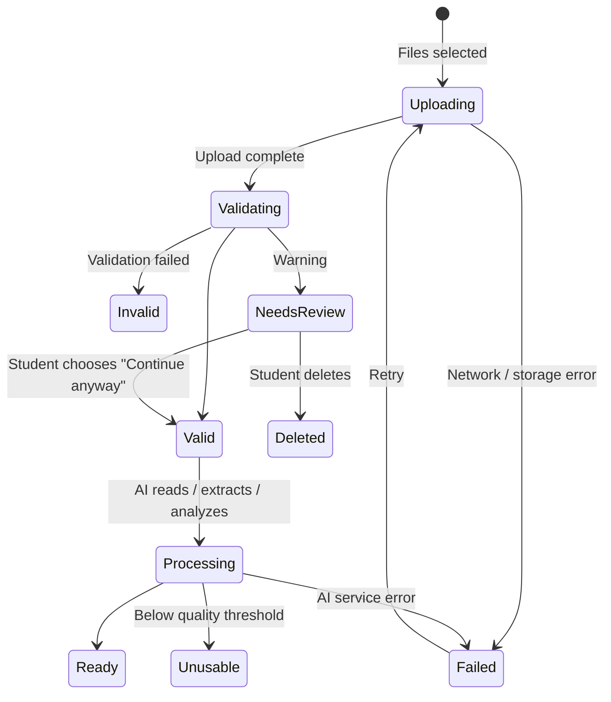
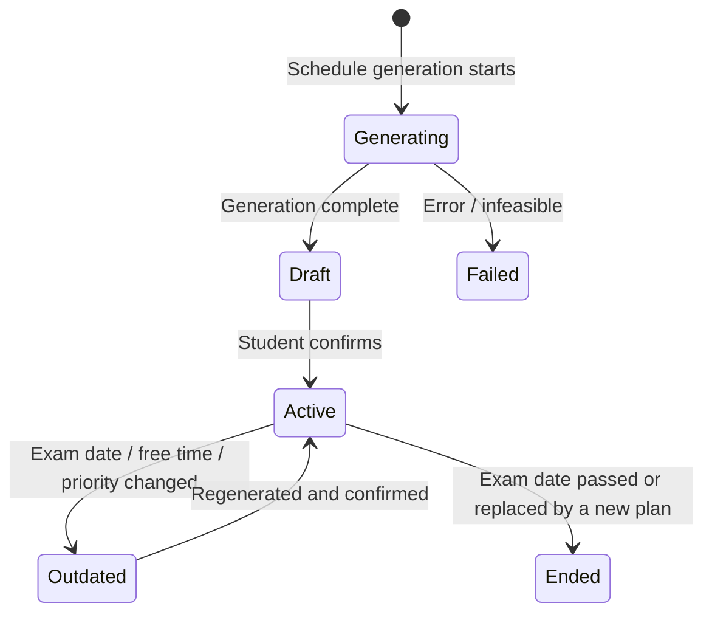
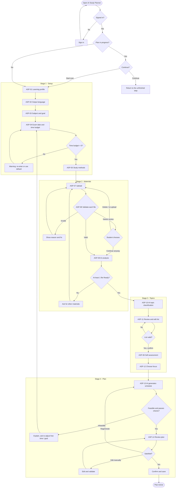

# AI STUDY PLANNER – AI-PERSONALIZED STUDY PLANS
 
# 1. Overview
 
## 1.1. Purpose
 
The AI Study Planner turns a student's own study materials into a day-by-day / week-by-week study plan that fits their goal, exam date, free time and current level of understanding.
 
The flow has 4 stages:
 
1. **Setup**: the student enters their profile, subject, goal, exam date, free time and preferred study methods.
2. **Materials**: the student uploads documents; the system validates the files and AI extracts the content.
3. **Topics**: AI splits the content into a topic list; the student edits and confirms it, self-assesses, and sets priorities.
4. **Plan**: AI schedules the topics into study sessions; the student edits and saves the plan.
## 1.2. Problems to solve
 
- Students have many materials in different formats but no tool to consolidate and organize the knowledge.
- Students spend a lot of time reading and sorting materials, and struggle to see what to prioritize.
- Students do not know how to divide their time sensibly before an exam.
- A one-size-fits-all study plan ignores differences in level, goals and available time.
## 1.3. Users
 
| Role | Description | Permissions in this feature |
| --- | --- | --- |
| Student | Lower-secondary (grades 6–9) and upper-secondary (grades 10–12) students | Full control to create, edit and confirm their own plans |
| Parent | Parent account linked to a student | View saved plans only depends on the account-linking feature being available (Q8) |
 
## 1.4. Value
 
- Saves the time spent consolidating and sorting materials.
- Makes it clear which topics to study, in what order, and for how long.
- Produces a schedule that fits real free time and finishes before the exam.
- Concentrates time on weak topics and priority topics.
## 1.5. Scope
 
**In scope:**
 
- The 14 functions ASP-01 to ASP-14 (Section 3).
- Saving the plan and handing it over to downstream features (task management, progress tracking).
**Out of scope:**
 
| Item | Reason / where it is handled |
| --- | --- |
| Generating in-session study content (summaries, flashcards, quizzes, exercises) | The plan only records the **activity type** of each session. Content is generated by the learning feature when the student opens a session (Q2) |
| Learning via podcast / video | High cost and complexity; phase 2 (Q1) |
| AI reading a photo of the school timetable | Phase 2; the MVP uses manual timetable entry |
| Placement test to measure understanding | The MVP uses self-assessment (Q3) |
| Direct import from Google Docs / Drive | Students upload an exported file (DOCX/PDF) (Q14) |
| Progress tracking after the plan is saved | Owned by the Progress Dashboard; this document only covers the integration point |
 
## 1.6. Success metrics
 
| Metric | Target |
| --- | --- |
| Share of students who open the feature and save a plan | ≥ 60% |
| Share of AI-generated topics kept (not deleted) | ≥ 80% |
| Share of plans regenerated more than 2 times before saving | ≤ 20% |
| Time from upload complete to topic list available (p90) | ≤ 2 minutes |
 
---
 
# 2. Glossary, shared values and configuration
 
This section is the **single source of truth** for value lists. Later sections reference these lists and do not redefine them.
 
## 2.1. Glossary
 
| Term | Definition |
| --- | --- |
| Learning profile | The student's personal and academic information, reused across plans |
| Study plan | A schedule of study sessions for **one subject**, tied to one exam date (or no exam date) |
| Material | A file uploaded by the student for a plan |
| Topic | A unit of knowledge with a name, description and estimated duration; belongs to a chapter and may have subpoints |
| Subpoint | Detailed content inside a topic |
| Prerequisite | Topic A is a prerequisite of B when A must be studied before B |
| Free slot | A self-study time window declared by the student, after removing school hours and busy days |
| Time budget | Total available study hours from today until the end of the day before the exam (calculated in ASP-04) |
| Study session | A continuous block of time within a free slot, assigned to one topic and one activity type |
| Focus | The priority level the student assigns to each topic |
 
## 2.2. Value lists
 
**School level and grade**
 
| School level | Valid grades |
| --- | --- |
| Lower secondary | 6, 7, 8, 9 |
| Upper secondary | 10, 11, 12 |
 
**Output language:** Vietnamese, English.
 
**Study methods (activity type within a session)**
 
| Code | Method | Description |
| --- | --- | --- |
| M1 | Read summary | Read a summary of the topic |
| M2 | Flashcards | Memorize concepts, formulas, definitions |
| M3 | Quiz | Short multiple-choice self-check |
| M4 | Practice exercises | Applied / open-ended exercises |
 
**Mastery level**
 
| Value | Display label | Description shown to the student |
| --- | --- | --- |
| 0 | Not started | This content is new to me |
| 1 | Struggling | I have studied it but still have gaps or make mistakes |
| 2 | Practicing | I understand the basics and need more practice |
| 3 | Mastered | I am confident with this content |
 
**Priority:** High, Medium, Low.
 
**Topic difficulty / importance:** Easy / Medium / Hard; High / Medium / Low.
 
**File status**
 

 
| Status | Display |
| --- | --- |
| Uploading | Uploading |
| Validating | Checking |
| Valid | Valid |
| NeedsReview | Needs review |
| Invalid | Invalid |
| Processing | Processing (Reading / Extracting / Analyzing) |
| Ready | Ready |
| Unusable | Unusable |
| Failed | Failed |
| Deleted | Deleted |
 
**Plan status**
 

 
| Status | Display | Meaning |
| --- | --- | --- |
| Generating | Generating | AI is building the schedule |
| Draft | Draft | Generated, not confirmed; freely editable |
| Active | Active | Confirmed; the official plan for the subject |
| Outdated | Outdated | Inputs changed after confirmation; still usable, regeneration recommended |
| Ended | Ended | Exam date passed or plan replaced; read-only |
| Failed | Failed | Schedule could not be generated; inputs are kept |
 
## 2.3. Configuration parameters
 
| ID | Parameter | Value |
| --- | --- | --- |
| CFG-01 | Maximum size per file | 20 MB |
| CFG-02 | Maximum files per selection | 10 |
| CFG-03 | Document processing quota | 5 files / month / student; resets at 00:00 on the 1st of each month in the student's time zone |
| CFG-04 | Minimum readable text for a document to be "usable" | 300 readable characters |
| CFG-05 | Minimum OCR confidence (document average) | 0.7 |
| CFG-06 | Target score scale | 0–10, step 0.25 |
| CFG-07 | Session length | Min 15 min, default 45 min, max 120 min |
| CFG-08 | Daily self-study limit (default, student-editable) | 3 hours |
| CFG-09 | Default study time when the student cannot declare free time | 1 hour/day, 19:00–20:00 |
| CFG-10 | Crash-review threshold | ≤ 7 days left until the exam |
| CFG-11 | Plan length when there is no exam date | 4 weeks |
| CFG-12 | Latest selectable exam date | 365 days from today |
| CFG-13 | Default duration for a topic without an estimate | 60 minutes |
| CFG-14 | Maximum plan regenerations per plan per day | 10 (failed generations do not count) |
| CFG-15 | Maximum topics per plan | 100 |
| CFG-16 | Share of the time budget reserved for final review | 15%, placed right before the exam |
| CFG-17 | Automatic retries on AI service error | 2 |
| CFG-18 | Retention period for original files | **[Open]** (Q10) |
 
---
 
# 3. Function list
 
5 business groups, 14 functions. ASP IDs are unchanged from v1 to preserve traceability; the **execution order** has changed (last column).
 
| Group | ID | Function | Summary | Step |
| --- | --- | --- | --- | --- |
| Setup | ASP-01 | Collect learning profile | School level, grade and supporting information | 1 |
| Setup | ASP-02 | Select output language | Language for all AI-generated content | 2 |
| Setup | ASP-03 | Select subject and goal | Subject, goal type, target score | 3 |
| Setup | ASP-04 | Set exam date and time budget | Exam date, school timetable, free time; calculate time budget | 4 |
| Setup | ASP-05 | Select study methods | Activity types wanted in study sessions | 5 |
| Materials | ASP-07 | Upload materials | Receive files, store them, manage quota | 6 |
| Materials | ASP-08 | Validate files | Format, size, integrity, content, duplicates | 7 |
| AI processing | ASP-09 | AI document analysis | Read, OCR, extract structure, assess usability | 8 |
| Topics | ASP-10 | Classify and organize topics | AI builds a Chapter → Topic → Subpoint tree with attributes | 9 |
| Topics | ASP-11 | Review and confirm topic list | Student edits, adds, deletes, confirms | 10 |
| Topics | ASP-06 | Self-assess understanding | Assign a mastery level to each confirmed topic | 11 |
| Topics | ASP-12 | Choose study focus | Set the priority of each topic | 12 |
| Plan | ASP-13 | AI schedule generation | Schedule topics into study sessions | 13 |
| Plan | ASP-14 | Review and save plan | Edit, confirm, save, hand over downstream | 14 |
 
> **Why ASP-06 moved after ASP-11:** v1 required understanding to be assessed "per topic" (ASP-06, AC-16) but placed this step *before* materials were uploaded, when no topics exist yet. Per-topic assessment is only possible once the topic list has been confirmed.
 
---
 
# 4. Flows
 
## 4.1. Main flow
 
**Stage 1 – Setup**
 
1. The student opens the AI Study Planner. If not signed in, the system redirects to sign-in and then returns.
2. If there is a plan in progress (Draft or mid-flow), the system asks "Continue" or "Start over".
3. The student confirms or updates the learning profile (ASP-01).
4. The student selects the output language (ASP-02).
5. The student selects the subject and goal (ASP-03).
6. The student enters the exam date, school timetable and free time; the system shows the time budget (ASP-04).
7. The student selects study methods (ASP-05).
**Stage 2 – Materials**
 
8. The student uploads one or more files (ASP-07).
9. The system validates each file independently (ASP-08).
10. AI reads, extracts and analyzes the valid files in the background (ASP-09).
**Stage 3 – Topics**
 
11. AI generates a structured topic list with attributes (ASP-10).
12. The student reviews, edits and confirms the list (ASP-11).
13. The student self-assesses each topic or skips (ASP-06).
14. The student adjusts priorities or keeps the defaults (ASP-12).
**Stage 4 – Plan**
 
15. AI generates a draft schedule; the system checks it against the hard rules (ASP-13).
16. The student reviews, edits or requests regeneration (ASP-14).
17. The student confirms; the system saves the plan as Active and hands it over to downstream features.
The system **auto-saves progress** after every step.
 
## 4.2. Flow diagram
 

 
## 4.3. Alternative flows
 
| # | Situation | System behavior | Reference |
| --- | --- | --- | --- |
| AF-01 | Optional fields skipped | Continue with the available data | ASP-01, ASP-03 |
| AF-02 | No exam date | Generate an even plan over CFG-11 | ASP-04, ASP-13 |
| AF-03 | Some files fail, some pass | Passing files continue; failed files show a reason and can be deleted or replaced | ASP-08 |
| AF-04 | AI cannot extract content | File becomes Unusable, no quota deducted, student can upload another version | ASP-09 |
| AF-05 | Student leaves while AI is processing | Processing continues in the background; a notification is sent when done | ASP-09, ASP-13 |
| AF-06 | Self-assessment skipped | All topics get Not started | ASP-06 |
| AF-07 | Focus selection skipped | AI default priorities are kept | ASP-12 |
| AF-08 | Student unhappy with the schedule | Edit manually or regenerate (limit CFG-14) | ASP-13, ASP-14 |
| AF-09 | Student exits before confirming the plan | Plan stays Draft; on return, ask to continue or start over | ASP-14 |
| AF-10 | Exam date / free time / priority changed after saving | Plan becomes Outdated; ask whether to regenerate; completed sessions are kept | ASP-14 |
| AF-11 | Subject already has an Active plan | Warning in ASP-03; when the new plan is confirmed, the old one becomes Ended | ASP-03, ASP-14 |
 
---
 
# 5. Functional specification
 
Every function follows the same template: Description → Preconditions → Inputs → Processing → Outputs → Business rules → Exception handling.
 
---
 
## ASP-01. Collect learning profile
 
**Description:** The student confirms or updates basic information so the system knows their school level and learning context. The profile is reused for all future plans.
 
**Preconditions:** The student is signed in.
 
**Inputs:**
 
| Field | Required | Values | Notes |
| --- | --- | --- | --- |
| School level | Yes | Lower secondary / Upper secondary | Prefilled from the profile if available |
| Grade | Yes | Per the table in 2.2 | List filtered by the selected school level |
| Country | No | Country list | Defaults from the account; used to suggest the output language |
| Native language | No | Language list | |
| Age | No | Integer 10–19 | Recommended for removal (Q9) |
| Learning difficulties | No | Multi-select: Hard to focus, Hard to remember, Lack of time, Don't know where to start, Other (≤ 200 characters) | Used to personalize explanations and session splitting |
 
**Processing:**
 
1. The system loads the existing profile and prefills the fields.
2. The student enters or edits information.
3. The system validates each field on blur and on Continue.
4. The system saves the profile to the account and moves to ASP-02.
**Outputs:** Saved learning profile.
 
**Business rules:**
 
| ID | Rule |
| --- | --- |
| BR01 | Only signed-in users can access the feature. |
| BR02 | The grade must belong to the selected school level (table 2.2). |
| BR03 | The profile belongs to the account, not to a plan. Editing it only affects plans created later and does not make an Active plan Outdated. |
| BR04 | Optional fields may be left empty. |
| BR05 | "Learning difficulties" is used only for personalization and is never shown to parents. |
 
**Exception handling:**
 
| Situation | Handling |
| --- | --- |
| Required field missing | Show an error on the field, do not save, keep entered data |
| Grade does not match school level | Show an error on the grade field |
| Profile fails to load | Show an empty form with a notice; allow retry |
| Save fails | Keep data on screen; allow retry |
 
---
 
## ASP-02. Select output language
 
**Description:** The student selects the language AI uses for all content generated in the plan: topic names and descriptions, session goals, explanations, warnings.
 
**Preconditions:** ASP-01 completed.
 
**Inputs:**
 
| Field | Required | Values |
| --- | --- | --- |
| Output language | Yes (has default) | Vietnamese / English |
 
Default: the app interface language if supported; otherwise English.
 
**Processing:**
 
1. The system shows the language list with the default preselected.
2. The student keeps or changes it.
3. The system saves the choice to the plan in progress.
**Outputs:** The plan's output language.
 
**Business rules:**
 
| ID | Rule |
| --- | --- |
| BR01 | Only languages in list 2.2 can be selected. |
| BR02 | All AI-generated content in the plan uses the selected language, even if the source materials are in another language. Source materials are not translated. |
| BR03 | The language is stored per plan. Changing it after a topic list or schedule exists only affects content generated afterwards; existing content changes only on regeneration. |
 
**Exception handling:**
 
| Situation | Handling |
| --- | --- |
| Save fails | Notify; allow retry |
 
---
 
## ASP-03. Select subject and goal
 
**Description:** The student selects the plan's subject and the goal they want to reach. AI uses the goal to decide depth and the share of practice.
 
**Preconditions:** ASP-02 completed.
 
**Inputs:**
 
| Field | Required | Values | Notes |
| --- | --- | --- | --- |
| Subject | Yes | Subjects available for the grade | Each plan covers **one** subject (Q7) |
| Goal type | Yes | Exam prep / Master the content / Improve score | |
| Target score | No | Per CFG-06 | Required if goal type is "Improve score" |
| Goal description | No | Text ≤ 300 characters | Example: "Entrance exam for the specialized math class in grade 10" |
 
**Processing:**
 
1. The system shows subjects available for the grade.
2. The student selects a subject and goal type, and enters a score and description if any.
3. The system validates the data.
4. If the subject already has an Active plan, the system notes that the new plan will replace it once confirmed.
5. The system saves and moves to ASP-04.
**Outputs:** The plan's subject and goal.
 
**Business rules:**
 
| ID | Rule |
| --- | --- |
| BR01 | Exactly one subject must be selected. |
| BR02 | The target score is within the CFG-06 scale. |
| BR03 | Each subject has at most one Active plan (see ASP-14 BR07). |
| BR04 | The goal can be edited until the plan is confirmed; editing it afterwards makes the plan Outdated. |
 
**Exception handling:**
 
| Situation | Handling |
| --- | --- |
| No subject selected | Error on the field |
| Score outside the scale | Error showing the valid scale |
| "Improve score" chosen without a score | Error on the score field |
| Save fails | Keep data; allow retry |
 
---
 
## ASP-04. Set exam date and time budget
 
**Description:** The student declares the exam date and the time available for self-study. The system computes the free slots and the time budget used by AI for scheduling.
 
**Preconditions:** ASP-03 completed.
 
**Inputs:**
 
| Field | Required | Values | Notes |
| --- | --- | --- | --- |
| Mode | Yes | With exam date / No exam date | |
| Exam date | Yes if "With exam date" | Date | |
| School timetable | No | Busy time slots by weekday | Manual entry. Timetable photo analysis: phase 2 |
| Self-study slots | Yes | Time slots by weekday | |
| Busy days / days off | No | List of dates | No sessions are scheduled on these days |
| Preferred session length | No | Within CFG-07 | Default per CFG-07 |
| Daily self-study limit | No | Hours | Default CFG-08 |
| Time zone | Automatic | From the device | Editable by the student |
 
**Processing:**
 
1. The student enters the data above.
2. The system validates each slot (start < end).
3. The system merges overlapping self-study slots within the same day.
4. The system removes the parts that overlap the school timetable and busy days, and highlights the removed parts for the student.
5. The system computes:
   - **Review period** = from today (counting only slots still in the future) to the end of the day before the exam. In no-exam mode: CFG-11 starting today.
   - **Free hours on day d** = min(total free slots on day d, daily limit).
   - **Time budget** = sum of free hours per day over the whole review period.
6. The system shows days remaining, the time budget and average free hours per week.
7. The system saves and moves to ASP-05.
**Outputs:** Free slots by day, days remaining, time budget.
 
**Business rules:**
 
| ID | Rule |
| --- | --- |
| BR01 | The exam date must be after today and no later than CFG-12. An exam date of today or in the past is **blocked** (not just warned about). |
| BR02 | Every slot must have a start time before its end time. |
| BR03 | Overlapping self-study slots are merged automatically without an error. |
| BR04 | No sessions are scheduled during school hours, on busy days, or on the exam day. |
| BR05 | The student cannot continue while the time budget is 0, unless they choose the default study time CFG-09. |
| BR06 | All time calculations use the student's time zone. |
| BR07 | Editing these fields after the plan is confirmed makes the plan Outdated. |
 
**Exception handling:**
 
| Situation | Handling |
| --- | --- |
| Exam date is today, in the past, or later than CFG-12 | Error; ask the student to choose again |
| Slot start ≥ end | Error on that row |
| Time budget = 0 | Warning; offer to re-enter free time or use the CFG-09 default |
| No school timetable entered | Treat as no school busy time; show a light reminder |
| Save fails | Keep data; allow retry |
 
> The warning "the time budget may not be enough for the topics" lives in ASP-11, because total topic duration is only known at that point.
 
---
 
## ASP-05. Select study methods
 
**Description:** The student selects the activity types they want in study sessions. ASP-13 uses this choice to assign an activity to each session.
 
**Preconditions:** ASP-04 completed.
 
**Inputs:** One or more methods from list 2.2 (M1–M4).
 
**Processing:**
 
1. The system shows 4 method cards with short descriptions.
2. The student selects one or more cards.
3. The system saves and moves to ASP-07.
**Outputs:** The plan's method list.
 
**Business rules:**
 
| ID | Rule |
| --- | --- |
| BR01 | At least 1 method must be selected. |
| BR02 | Every session in the schedule uses only methods from the selected list (ASP-13). |
| BR03 | Changing methods after the plan is confirmed only takes effect on regeneration; it does not make the plan Outdated. |
 
**Exception handling:**
 
| Situation | Handling |
| --- | --- |
| No method selected | Continue button disabled with the hint "Choose at least 1 way to study" |
| Save fails | Notify; allow retry |
 
> v1 had the exception "material too short to generate a quiz". That belongs to the content generation feature (out of scope, Q2).
 
---
 
## ASP-07. Upload materials
 
**Description:** The student uploads one or more files as the source AI uses to build the topic list.
 
**Preconditions:** ASP-05 completed. The student has quota left (CFG-03).
 
**Inputs:**
 
| Field | Notes |
| --- | --- |
| Files | Supported formats: PDF, DOC, DOCX, PPT, PPTX, JPG, JPEG, PNG |
| Subject | From ASP-03 |
 
**Processing:**
 
1. The system shows the upload area, supported formats, size limit (CFG-01) and remaining uploads this month.
2. The student selects files (drag and drop or file picker; on mobile, taking a photo is allowed).
3. The system runs quick client-side checks: extension, size, file count (CFG-02), remaining quota.
4. The system uploads the files to private storage and shows per-file progress.
5. The system links each file to the account and the plan in progress, and passes it to ASP-08.
**Outputs:** File list with status (2.2) and remaining quota.
 
**Business rules:**
 
| ID | Rule |
| --- | --- |
| BR01 | Only the formats listed above are accepted. |
| BR02 | Each file ≤ CFG-01; each selection ≤ CFG-02 files. |
| BR03 | **Quota:** each file that reaches Ready (after ASP-09) deducts 1 upload. Rejected, failed, duplicate or Unusable files **do not** deduct quota. |
| BR04 | The system blocks selecting more files when (files pending processing + new files) exceeds the remaining quota. |
| BR05 | Files are stored privately; only the account owner can access them. |
| BR06 | The student can delete files until ASP-10 starts. |
| BR07 | At least 1 Ready file is required to continue to ASP-10. |
 
**Exception handling:**
 
| Situation | Handling |
| --- | --- |
| Unsupported format | Reject the file; show supported formats |
| Larger than CFG-01 | Reject the file; show the limit |
| More than CFG-02 files selected | Reject the selection; show the maximum |
| Monthly quota used up | Block upload; show the quota reset date |
| Network lost during upload | File becomes Failed; allow retry; no quota deducted |
| Storage error | File becomes Failed; notify; allow retry |
| No files yet | Continue button disabled |
 
---
 
## ASP-08. Validate files
 
**Description:** Validate each received file before AI processing, and tell the student exactly why a file was rejected and how to fix it.
 
**Preconditions:** File is in Validating status.
 
**Inputs:** File, file name, size, file content.
 
**Processing:**
 
1. **Format:** detect the real file type from its content (not only the extension) and compare with the supported list.
2. **Size:** compare with CFG-01 (re-checked server-side).
3. **Integrity:** the file opens, is not corrupted, and has no password.
4. **Content:** contains readable text or images; for images, check sharpness.
5. **Duplicates:** compare the file fingerprint (hash) with other files in the same plan.
6. Assign a result using the reason code table below.
**Reason codes:**
 
| Code | Reason | Result | Guidance shown to the student |
| --- | --- | --- | --- |
| F01 | Unsupported format (including a faked extension) | Invalid | "Please upload a PDF, Word, PowerPoint or JPG/PNG image" |
| F02 | Exceeds size limit | Invalid | "The file is larger than [CFG-01]. Compress or split it" |
| F03 | Corrupted, cannot be opened | Invalid | "The file is damaged. Try opening it on your device and saving it again" |
| F04 | Password-protected | Invalid | "Remove the password and upload again" |
| F05 | No readable content | Invalid | "We couldn't find any text in this file" |
| F06 | Exact duplicate of a file already in the plan | Removed automatically | "This file is already uploaded" |
| F07 | Blurry or low-quality image | Needs review | Two options: "Retake photo" / "Continue anyway" |
| F08 | Only partly readable (e.g., some pages broken) | Needs review | "Some pages couldn't be read: [page numbers]" with "Continue anyway" / "Delete" |
 
**Outputs:** Validation result per file (Valid / Needs review / Invalid) with reason code.
 
**Business rules:**
 
| ID | Rule |
| --- | --- |
| BR01 | Each file is validated independently; one failed file does not block others. |
| BR02 | Every non-Valid result must include a reason code and fix guidance. |
| BR03 | Only Valid files, or Needs review files where the student chose "Continue anyway", go to ASP-09. |
| BR04 | Password-protected files are always rejected; the system does not accept passwords. |
 
**Exception handling:**
 
| Situation | Handling |
| --- | --- |
| Validation service error | File becomes Failed; allow re-validation; no quota deducted |
 
---
 
## ASP-09. AI document analysis
 
**Description:** AI reads valid files, extracts text (with OCR when needed), detects structure and decides whether the material is good enough to build topics from.
 
**Preconditions:** At least 1 file passed from ASP-08.
 
**Inputs:** Valid files, subject, output language.
 
**Processing:**
 
1. **Read:** identify the file type and the right extraction method.
2. **Extract:** extract text; use OCR for images and scanned pages; keep the page / slide number of each passage.
3. **Detect structure:** headings, subheadings, chapters, sections, lists, tables.
4. **Analyze content:** flag passages duplicated across files; assess relevance to the subject.
5. **Assess usability:**
   - **Ready** if: readable characters ≥ CFG-04 **and** (for images/scans) OCR confidence ≥ CFG-05.
   - **Unusable** if either condition is not met.
   - Content judged unrelated to the subject: still Ready, with a warning; the student chooses to keep or delete it.
6. The system updates each file's status and deducts quota for Ready files (ASP-07 BR03).
Processing runs in the background. The student can leave the screen and is notified when it finishes.
 
**Outputs:**
 
- Structured content for each file (headings, chapters, passages, tables); every passage is linked to its source file and page.
- Status per file: Ready / Unusable / Failed, with reason.
**Business rules:**
 
| ID | Rule |
| --- | --- |
| BR01 | Only files that passed ASP-08 are processed. |
| BR02 | All extracted content must keep a link to its source file and page (so topics can be traced back to the source). |
| BR03 | AI service errors are retried automatically up to CFG-17 times before reporting Failed. |
| BR04 | Unusable or Failed files do not deduct quota. |
| BR05 | Student materials are not used to train AI models. **[Open]** legal sign-off (Q10) |
 
**Exception handling:**
 
| Situation | Handling |
| --- | --- |
| Below CFG-04 / CFG-05 threshold | Unusable; suggest uploading a clearer or text-based version |
| Partial extraction | Ready with a warning listing the broken pages |
| Content unrelated to the subject | Warning; keep or delete |
| AI service error after CFG-17 retries | Failed; keep the file; show a Retry button |
| No usable files at all | Block moving on; ask for other materials |
 
---
 
## ASP-10. Classify and organize topics
 
**Description:** AI turns the extracted content into a Chapter → Topic → Subpoint tree, giving each topic all the attributes needed for scheduling.
 
**Preconditions:** At least 1 Ready file.
 
**Inputs:** Structured content from ASP-09, subject, grade, goal, output language.
 
> v1 used "current level of understanding" as an input here, but understanding is only known after ASP-06. That input is removed; only ASP-13 uses mastery levels.
 
**Processing:**
 
1. Identify knowledge topics.
2. Merge exact duplicate topics; flag partially overlapping topics for the student to review.
3. Assign topics to chapters from the material; if the material has no chapters, group by content and flag "uncertain chapter".
4. Split each topic into subpoints.
5. Give each topic a short name (≤ 100 characters, unique) and a short description (≤ 300 characters), in the output language.
6. Identify prerequisites. If a cycle is detected, drop the edge that causes it, keep the source order and flag it for review.
7. Propose a study order: by prerequisites first, then by order of appearance in the material.
8. Assign difficulty, importance (based on the goal and the material) and estimated duration.
9. Set **default priority = importance**. The student adjusts it in ASP-12.
10. The system runs consistency checks: unique names, no prerequisite cycles, every topic has at least one source, topic count ≤ CFG-15.
**Outputs – attributes per topic:**
 
| Attribute | Required | Values |
| --- | --- | --- |
| Name | Yes | ≤ 100 characters, unique within the plan |
| Short description | Yes | ≤ 300 characters |
| Chapter | Yes | Chapter name (or a group named by AI) |
| Subpoints | No | List |
| Difficulty | Yes | Easy / Medium / Hard |
| Importance | Yes | High / Medium / Low |
| Estimated duration | Yes | Minutes |
| Prerequisites | No | List of topics |
| Suggested order | Yes | Sequence number |
| Default priority | Yes | High / Medium / Low |
| Source | Yes | File + page |
| Review flags | No | Overlap / Uncertain chapter / Inconsistent prerequisite |
 
**Business rules:**
 
| ID | Rule |
| --- | --- |
| BR01 | Only content from Ready files is classified. |
| BR02 | No two topics in a plan share a name. |
| BR03 | Every topic must trace back to at least one passage in the source material; AI must not create topics without a source. |
| BR04 | Prerequisite relations must not form cycles. |
| BR05 | If there is not enough data to determine relations, keep the source order and leave topics independent. |
| BR06 | If the count exceeds CFG-15, AI merges small topics within the same chapter until the limit is met. |
 
**Exception handling:**
 
| Situation | Handling |
| --- | --- |
| No topics identified | Ask for more materials, or let the student create topics manually in ASP-11 |
| Content does not match the selected subject | Warning; let the student change the subject or continue |
| Missing duration estimate | Use CFG-13 and flag it |
| AI service error | Auto-retry CFG-17 times; then allow manual retry |
 
---
 
## ASP-11. Review and confirm topic list
 
**Description:** The student checks the AI-generated list, edits it to fit their needs and confirms it. Only a confirmed list is used for scheduling.
 
**Preconditions:** ASP-10 completed.
 
**Inputs:** Topic set from ASP-10, time budget from ASP-04, student actions.
 
**Processing:**
 
**A. Display**
 
1. Show topics grouped by chapter, with description, duration, difficulty and any review flags.
2. Show **total duration vs. time budget**, e.g. "32 hours / 40 hours available". If it exceeds the budget, show a warning with the hour shortfall.
**B. Edit**
 
| Action | MVP | Notes |
| --- | --- | --- |
| Rename topic | Yes | Checks for empty / duplicate names |
| Edit description | Yes | ≤ 300 characters |
| Add study note | Yes | ≤ 500 characters; e.g. "Teacher said to focus on graph questions". ASP-13 uses it when writing session goals |
| Add topic | Yes | Student enters a name, selects a chapter, enters a duration (default CFG-13) |
| Delete topic | Yes | Asks for confirmation if the topic is a prerequisite of another |
| Resolve overlap flag | Yes | Keep both / Merge / Delete one |
| Reorder within a chapter | Phase 2 | |
| Merge any two topics | Phase 2 | |
| Undo / Reset to AI version | Yes | |
 
After every change, the system immediately updates the total duration and warnings.
 
**C. Confirm**
 
1. The student taps "Confirm list".
2. The system checks: ≥ 1 topic, no empty names, no duplicates.
3. The system saves the list and moves to ASP-06.
**Outputs:** Confirmed topic list (with study notes if any).
 
**Business rules:**
 
| ID | Rule |
| --- | --- |
| BR01 | Topic names cannot be empty or duplicated within the plan. |
| BR02 | The list must have at least 1 topic to be confirmed. |
| BR03 | Student-added topics are labeled "Added by you" and do not need a source. |
| BR04 | Deleting a prerequisite topic also deletes the related prerequisite relations. |
| BR05 | Editing the list after confirmation discards the self-assessment and focus of deleted topics; new topics get default values. |
 
**Exception handling:**
 
| Situation | Handling |
| --- | --- |
| Empty or duplicate name | Error on the input; keep the old name |
| All topics deleted | Block confirmation; ask to keep or add at least 1 topic |
| Adding beyond CFG-15 | Block adding; show the limit |
| Save fails | Keep changes on screen; allow retry |
 
---
 
## ASP-06. Self-assess understanding
 
**Description:** The student says how well they know each topic, so AI can put more time into weak topics and less into topics they already know.
 
**Preconditions:** Topic list confirmed (ASP-11).
 
**Inputs:** Mastery level (2.2) for each topic.
 
**Processing:**
 
1. Show the question "Where are you with each topic?" and the topic list by chapter.
2. The student selects a level for each topic, or one level for a whole chapter.
3. The student taps Continue or Skip.
4. The system saves; unassessed topics get Not started.
**Outputs:** Initial mastery level of each topic.
 
**Business rules:**
 
| ID | Rule |
| --- | --- |
| BR01 | Each topic has exactly one mastery level. |
| BR02 | This step is optional; the default is Not started. |
| BR03 | Mastery levels can be edited until the plan is confirmed. After that, they are updated by the progress tracking feature. |
| BR04 | Initial mastery levels are handed over to the Progress Dashboard. |
 
**Exception handling:**
 
| Situation | Handling |
| --- | --- |
| Save fails | Keep selections on screen; allow retry |
 
---
 
## ASP-12. Choose study focus
 
**Description:** The student decides which topics deserve the most time. The system immediately shows what share of the time budget that decision takes.
 
**Preconditions:** ASP-06 completed or skipped.
 
**Inputs:** Priority (High / Medium / Low) for each topic, defaulted from ASP-10.
 
**Processing:**
 
1. Show the question "Where should we focus most?" and the topic list with default priorities.
2. The student changes the priority of individual topics.
3. The system immediately updates the **expected share of the time budget for High-priority topics** (using the formula in ASP-13 B1).
4. The student taps Generate plan or Skip (keeping the defaults).
5. The system saves and moves to ASP-13.
**Outputs:** Final priority of each topic.
 
**Business rules:**
 
| ID | Rule |
| --- | --- |
| BR01 | Priorities can only be set for topics in the confirmed list. |
| BR02 | Each topic has exactly one priority. |
| BR03 | This step is optional; skipping keeps the defaults. |
| BR04 | Changing priorities after the plan is confirmed makes the plan Outdated. |
 
**Exception handling:**
 
| Situation | Handling |
| --- | --- |
| All topics set to High | Warning "When everything is a priority, nothing is"; the student can still continue |
| High-priority topics alone exceed the time budget | Warning with the hour shortfall; suggest lowering some priorities or adding free time |
| Save fails | Keep selections; allow retry |
 
---
 
## ASP-13. AI schedule generation
 
**Description:** AI schedules the confirmed topics into free slots to produce a day/week study schedule. The system checks the schedule against hard rules before showing it.
 
**Preconditions:**
 
- Topic list confirmed, ≥ 1 topic.
- Time budget > 0 (or the student chose the default study time).
- ≥ 1 study method selected.
**Inputs:** Topics with attributes, mastery levels, priorities, study notes; goal and target score; exam date or no-exam mode; free slots; session/day limits; study methods; output language.
 
**Processing:**
 
**A. Choose mode**
 
| Condition | Mode | Scope |
| --- | --- | --- |
| More than CFG-10 days left | Normal | All topics |
| CFG-10 days or fewer left | Crash review | Only High-priority topics and topics at Not started / Struggling; the student is told clearly |
| No exam date | Even pace | Spread evenly over CFG-11 |
 
**B. Calculate time needed**
 
1. Need per topic = Estimated duration × Mastery factor × Priority factor.
   | Mastery level | Factor |  | Priority | Factor |
   | --- | --- | --- | --- | --- |
   | Not started | 1.0 |  | High | 1.3 |
   | Struggling | 1.2 |  | Medium | 1.0 |
   | Practicing | 0.7 |  | Low | 0.7 |
   | Mastered | 0.3 (review only) |  |  |  |
   > These factors are starting values; tune them with real usage data (Q11).
2. Reserve CFG-16 of the time budget for final review, placed right before the exam (not applied in Even pace mode).
3. Compare total need with the remaining budget:
   - **Enough:** schedule everything; extra time becomes additional practice sessions for High-priority topics.
   - **Not enough:** drop Low-priority topics first, then Medium (within the same priority, drop Mastered topics first). Dropped topics go into the "Unscheduled" list.
   - **Not enough even for High-priority topics alone:** do not generate a schedule (see exceptions).
**C. Schedule**
 
1. Order topics: prerequisites first, then by priority, then by source order.
2. Split each topic's need into sessions within CFG-07, preferring the student's preferred session length.
3. Place sessions in the earliest available free slots without exceeding the daily limit.
4. Assign a method to each session: the first session of a topic uses Read summary (if selected); the last session uses Quiz (if selected); sessions in between rotate through the remaining selected methods.
5. Write a goal for each session (≤ 150 characters), taking the topic's study note into account.
6. Write a short explanation of how the schedule was built (e.g., why topic X has more sessions).
**D. Post-generation check (by the system, not AI)**
 
The schedule must satisfy every **hard rule**:
 
| Code | Hard rule |
| --- | --- |
| H1 | Every session is inside a free slot |
| H2 | Every session ends before the exam date |
| H3 | No two sessions overlap |
| H4 | Every session is within CFG-07; each day's total ≤ the daily limit |
| H5 | A prerequisite topic's first session comes before the first session of its dependent topic (except relations flagged as inconsistent) |
| H6 | Every confirmed topic has ≥ 1 session or is in the Unscheduled list |
| H7 | Every session has a method from the selected list and a goal |
| H8 | All text is in the output language |
 
On a violation: the system fixes it automatically (move / split sessions) if possible; otherwise it asks AI to regenerate, up to CFG-17 times; if it still fails, the status is Failed. **A schedule that violates a hard rule is never shown.**
 
**Outputs – draft plan:**
 
| Level | Content |
| --- | --- |
| Plan | Mode, total duration, number of sessions, Unscheduled list, warnings, explanation |
| Session | Date, start–end time, topic, subpoints, duration, method, session goal |
 
Generation status: Generating / Complete / Complete with warnings / Failed.
 
**Business rules:**
 
| ID | Rule |
| --- | --- |
| BR01 | Only the confirmed topic list is used. |
| BR02 | The schedule must satisfy H1–H8. |
| BR03 | For two topics with the same difficulty and mastery level, the higher-priority topic gets more time. |
| BR04 | For two topics with the same priority, a Struggling topic gets more time than a Mastered topic; Mastered topics only get review sessions. |
| BR05 | An AI-generated schedule stays in Draft until the student confirms it. |
| BR06 | The student can regenerate up to CFG-14 times per day; failed generations do not count. |
| BR07 | Regenerating replaces the whole draft, including the student's manual edits; the system warns beforehand (Q15). |
 
**Exception handling:**
 
| Situation | Handling |
| --- | --- |
| Time budget not enough | Drop topics per B3, list Unscheduled topics, suggest how many hours to add |
| Not enough time for High-priority topics alone | Do not generate; explain (need X hours, have Y hours); suggest adding free time, lowering priorities or moving the exam date |
| CFG-10 days or fewer left | Crash review mode, with a notice |
| Prerequisite flagged as inconsistent | Keep source order; show the flag in the plan |
| AI error / rule violation after CFG-17 attempts | Failed; keep all inputs; Retry button; does not count toward CFG-14 |
| CFG-14 regenerations used up | Block regeneration and show when it becomes available; manual editing still allowed |
 
---
 
## ASP-14. Review and save plan
 
**Description:** The student reviews the draft plan, edits it if needed and confirms it. A confirmed plan becomes the official plan for the subject and is handed over to downstream features.
 
**Preconditions:** A plan exists in Draft status.
 
**Inputs:** Draft plan, free slots, busy time, exam date, session/day limits, student actions.
 
**Processing:**
 
**A. View**
 
1. Show the schedule by week (default) or by day.
2. Each session shows: time, topic, duration, method, goal.
3. Show a summary: total hours, number of sessions, Unscheduled topics, warnings, AI explanation.
**B. Manual edits**
 
| Action | Notes |
| --- | --- |
| Move a session to another day/time | Drag and drop or edit directly |
| Change session length | Within CFG-07 |
| Change a session's topic or method | Only within the confirmed topics / selected methods |
| Add / delete a session | |
| Place an Unscheduled topic into a time slot | |
| Undo / Reset to AI version | |
 
Every change is checked immediately and falls into one of two classes:
 
| Class | Cases | Behavior |
| --- | --- | --- |
| Blocking error | Overlaps school hours or a busy day; after or on the exam date; in the past; overlaps another session; length outside CFG-07 | Reject the change, highlight the violating session, keep the old value |
| Soft warning | Exceeds the daily limit; breaks prerequisite order; a topic has no sessions left; outside declared self-study slots | Allow the student to continue or undo |
 
**C. Confirm and save**
 
1. The student taps "Confirm and save".
2. The system checks: the plan is not empty and has no blocking errors.
3. If the subject already has an Active plan, the system asks the student to confirm the replacement.
4. The system saves the plan with a unique plan ID and status Active; the old plan (if any) becomes Ended.
5. The system hands the plan over to task management and the Progress Dashboard and shows a success message.
**After saving:**
 
- The student can edit future sessions under the same validation rules.
- Past or completed sessions are locked.
- Changing the exam date, free time, goal or priorities → the plan becomes Outdated; the system asks whether to regenerate. Regeneration keeps completed sessions and progress.
**Outputs:** Active plan with a plan ID.
 
**Business rules:**
 
| ID | Rule |
| --- | --- |
| BR01 | A plan can only be confirmed when it has ≥ 1 session and no blocking errors. |
| BR02 | Confirmation is idempotent: tapping multiple times or on two devices creates only one plan. |
| BR03 | The plan is linked to the student's account; only the owner and a linked parent can view it. |
| BR04 | Parents can view only, not edit, and cannot see "Learning difficulties". |
| BR05 | Past or completed sessions cannot be edited. |
| BR06 | Drafts are auto-saved; exiting midway does not lose changes. |
| BR07 | Each subject has at most one Active plan. |
| BR08 | A plan becomes Ended automatically after the exam date. |
 
**Exception handling:**
 
| Situation | Handling |
| --- | --- |
| Empty plan | Block confirmation; ask to regenerate |
| Save fails | Keep the plan on screen; allow retry; no duplicate created |
| Exit before confirming | Keep as Draft; on return, ask "Continue" or "Start over" |
 
---
 
# 6. Acceptance criteria
 
Each criterion can be tested independently. Specific values come from the CFG table in Section 2.3 at the time of testing.
 
## A. Access and learning profile (ASP-01)
 
| ID | Acceptance criterion |
| --- | --- |
| AC-01 | When a signed-out user opens the AI Study Planner, the system redirects to sign-in and returns the user to the AI Study Planner after a successful sign-in. |
| AC-02 | When the student has a plan in progress, the system asks "Continue" or "Start over"; choosing "Continue" returns the student to the unfinished step with their entered data. |
| AC-03 | When the student submits a valid school level and grade, the system saves the profile and moves to the language step. |
| AC-04 | When a required field is missing, the system does not save, shows an error on each invalid field and keeps the entered data. |
| AC-05 | When the grade does not belong to the school level (e.g., Lower secondary – grade 11), the system shows an error on the grade field. |
 
## B. Output language (ASP-02)
 
| ID | Acceptance criterion |
| --- | --- |
| AC-06 | The student can select Vietnamese or English; all topic names, descriptions, session goals and explanations generated by AI in the plan use the selected language. |
| AC-07 | When the student does not change the selection, the system uses the interface language (or English if the interface language is not supported) and shows the language in use. |
 
## C. Subject and goal (ASP-03)
 
| ID | Acceptance criterion |
| --- | --- |
| AC-08 | When the student submits a subject, goal type and a score within the CFG-06 scale, the system saves and moves to the exam date step. |
| AC-09 | When the subject is missing, the score is outside the scale, or "Improve score" is chosen without a score, the system shows an error on the invalid field and does not save. |
| AC-10 | When the subject already has an Active plan, the system notes that the new plan will replace it once confirmed. |
 
## D. Exam date and time budget (ASP-04)
 
| ID | Acceptance criterion |
| --- | --- |
| AC-11 | When the student enters an exam date after today and within CFG-12, the system saves it and shows the days remaining. |
| AC-12 | The system rejects an exam date that is today, in the past, or later than CFG-12, and asks the student to choose again. |
| AC-13 | When the student submits a valid school timetable and self-study slots, the system shows a time budget calculated with the formula in ASP-04 step 5 and highlights slot parts removed because they overlap school hours. |
| AC-14 | The system shows an error on any row where the start time ≥ the end time. |
| AC-15 | Two overlapping self-study slots on the same day are merged into one without an error. |
| AC-16 | When the time budget is 0, the system blocks continuing and lets the student re-enter free time or use the CFG-09 default. |
| AC-17 | When the student chooses "No exam date", the plan is spread evenly over CFG-11. |
 
## E. Study methods (ASP-05)
 
| ID | Acceptance criterion |
| --- | --- |
| AC-18 | The student can select one or more methods from M1–M4, and the system saves the selection. |
| AC-19 | When no method is selected, the Continue button is disabled. |
 
## F. Upload and file validation (ASP-07, ASP-08)
 
| ID | Acceptance criterion |
| --- | --- |
| AC-20 | Valid PDF, DOC, DOCX, PPT, PPTX, JPG, JPEG and PNG files upload with a progress bar and move to Valid. |
| AC-21 | Files in an unsupported format (including faked extensions) are rejected with code F01 and the list of supported formats; no quota is deducted. |
| AC-22 | Files larger than CFG-01 are rejected with code F02, showing the limit; no quota is deducted. |
| AC-23 | Corrupted, password-protected or empty files are rejected with code F03 / F04 / F05 and fix guidance; no quota is deducted. |
| AC-24 | When more than CFG-02 files are selected at once, the system rejects the selection and shows the maximum. |
| AC-25 | When the student has used up the CFG-03 quota, the system blocks uploading and shows the quota reset date. |
| AC-26 | A blurry image is marked Needs review (F07) with the options "Retake photo" and "Continue anyway". |
| AC-27 | A file that is an exact duplicate of one already in the plan is removed automatically (F06), is not processed again, and does not deduct quota. |
| AC-28 | When the network drops during upload, the file becomes Failed with a Retry button; no quota is deducted. |
| AC-29 | In a multi-file upload, one failed file does not stop the others. |
| AC-30 | The student can delete a file before topic classification starts; deleted files are not used to create topics. |
 
## G. Document analysis (ASP-09)
 
| ID | Acceptance criterion |
| --- | --- |
| AC-31 | The system extracts text from text-based PDF, DOCX and PPTX files. |
| AC-32 | The system uses OCR to extract text from photos and scanned PDFs. |
| AC-33 | A file that meets CFG-04 and CFG-05 becomes Ready, deducts 1 upload, and the remaining quota is updated. |
| AC-34 | A file below the thresholds becomes Unusable with a suggestion to upload a clearer version; no quota is deducted. |
| AC-35 | Every extracted passage can be traced back to its source file and page. |
| AC-36 | During processing, the system shows progress; the student can leave the screen and is notified when processing finishes. |
| AC-37 | Material judged unrelated to the subject triggers a warning and lets the student keep or delete it. |
| AC-38 | When the AI service fails, the system retries CFG-17 times; if it still fails, the file becomes Failed with a Retry button and the file is kept. |
 
## H. Topic classification and topic list (ASP-10, ASP-11)
 
| ID | Acceptance criterion |
| --- | --- |
| AC-39 | AI builds a Chapter → Topic → Subpoint tree; every topic has all required attributes from the ASP-10 output table. |
| AC-40 | Every AI-generated topic has at least one viewable source (file + page). |
| AC-41 | Exact duplicate topics are merged; partially overlapping topics are flagged for the student. |
| AC-42 | When the material has no chapters, topics are grouped by content and flagged "Uncertain chapter". |
| AC-43 | When prerequisite relations form a cycle, the system drops the edge causing it, keeps the source order and flags it. |
| AC-44 | The list is shown by chapter with description, per-topic duration and total duration vs. time budget. |
| AC-45 | When total duration exceeds the time budget, the system shows a warning with the hour shortfall. |
| AC-46 | The student can edit the name, description and study note; changes appear immediately. |
| AC-47 | When a topic name is empty or duplicated, the system shows an error on the input and keeps the old name. |
| AC-48 | When topics are added or deleted, the total duration and warnings update immediately. |
| AC-49 | When deleting a topic that is a prerequisite of another, the system asks for confirmation. |
| AC-50 | When all topics are deleted, the system blocks confirmation and asks to keep or add at least 1 topic. |
| AC-51 | The student can undo the last change and reset to the original AI list. |
| AC-52 | When the student confirms a valid list, the system saves it and moves to self-assessment. |
 
## I. Self-assessment (ASP-06)
 
| ID | Acceptance criterion |
| --- | --- |
| AC-53 | The student can assign one of 4 levels (Not started, Struggling, Practicing, Mastered) to each topic, or to a whole chapter at once. |
| AC-54 | When the student skips, every unassessed topic gets Not started. |
 
## J. Study focus (ASP-12)
 
| ID | Acceptance criterion |
| --- | --- |
| AC-55 | The screen shows the AI default priority for each topic; the student can change each one. |
| AC-56 | The expected share of the time budget for High-priority topics updates immediately after each change. |
| AC-57 | When High-priority topics alone exceed the time budget, the system shows a warning with the hour shortfall. |
| AC-58 | When the student skips, the default priorities are kept. |
 
## K. Schedule generation (ASP-13)
 
| ID | Acceptance criterion |
| --- | --- |
| AC-59 | Every session is inside a free slot, does not overlap school hours or other sessions, and ends before the exam date (H1–H3). |
| AC-60 | No session is outside CFG-07 and no day exceeds the daily limit (H4). |
| AC-61 | A prerequisite topic's first session takes place before the first session of its dependent topic (H5). |
| AC-62 | Every confirmed topic has at least 1 session or is in the Unscheduled list (H6). |
| AC-63 | Every session has a method from the student's selection and a session goal (H7). |
| AC-64 | For two topics with the same difficulty and mastery level, the High-priority topic gets more total time than the Low-priority topic. |
| AC-65 | For two topics with the same priority, a Struggling topic gets more total time than a Mastered topic; Mastered topics only get review sessions. |
| AC-66 | When the time budget is not enough, the system drops Low-priority topics first, lists Unscheduled topics and suggests how many hours to add. |
| AC-67 | When CFG-10 days or fewer remain, the schedule contains only High-priority topics and Not started / Struggling topics, with a crash-review notice. |
| AC-68 | When there is not enough time for High-priority topics alone, the system does not generate a schedule and shows hours needed vs. hours available, with suggestions. |
| AC-69 | When AI fails after CFG-17 attempts, the system reports Failed, keeps all inputs, allows retry and does not count it toward CFG-14. |
| AC-70 | No schedule that violates H1–H8 is ever shown to the student. |
| AC-71 | The draft plan includes an explanation of how it was built, in the output language. |
| AC-72 | The student can regenerate up to CFG-14 times per day; the system warns beforehand that manual edits will be lost. |
 
## L. Review, edit and save (ASP-14)
 
| ID | Acceptance criterion |
| --- | --- |
| AC-73 | The draft plan can be viewed by week and by day; each session shows date, time, topic, duration, method and goal, plus total duration, Unscheduled topics, warnings and explanation. |
| AC-74 | The student can move a session to a valid slot; total duration and warnings update. |
| AC-75 | When a change causes a blocking error (overlaps busy time, on/after the exam date, in the past, overlaps another session), the system rejects it, highlights the violating session and keeps the old value. |
| AC-76 | When a change causes a soft warning, the system lets the student continue or undo. |
| AC-77 | The student can undo the last change and reset to the original AI version. |
| AC-78 | When a plan with no blocking errors is confirmed, the system saves it with a unique ID and status Active and shows a success message. |
| AC-79 | When the plan is empty, the system blocks confirmation and asks to regenerate. |
| AC-80 | Tapping confirm multiple times or on two devices creates only one plan. |
| AC-81 | When saving fails, the plan stays on screen, retry is allowed, and no duplicate is created. |
| AC-82 | When the student exits before confirming, the plan stays Draft; on return, the system asks "Continue" or "Start over". |
| AC-83 | Past or completed sessions cannot be edited. |
| AC-84 | When the exam date, free time, goal or priorities change after saving, the plan becomes Outdated and the system asks whether to regenerate; regeneration keeps completed sessions. |
| AC-85 | When confirming a new plan for a subject that already has an Active plan, the system asks for confirmation; afterwards the old plan becomes Ended. |
 
## M. Integration and permissions
 
| ID | Acceptance criterion |
| --- | --- |
| AC-86 | The saved plan appears on **[Open: name of the study management screen]** with its plan ID and status. |
| AC-87 | The Progress Dashboard shows initial progress for the saved plan (0% complete, initial mastery level of each topic). |
| AC-88 | Only the account owner and a linked parent can view the materials and plan; other accounts are denied access. |
| AC-89 | Parents cannot edit the plan and cannot see the "Learning difficulties" field. |
 
---
 
# 7. Non-functional requirements
 
| Area | Requirement |
| --- | --- |
| Performance | File validation (ASP-08) ≤ 5 seconds per file. Document analysis until the topic list is ready: p90 ≤ 2 minutes for 20 MB total. Schedule generation: p90 ≤ 60 seconds. Total duration update after each edit: ≤ 300 ms. |
| Reliability | Progress auto-saved after every step. AI processing runs in the background and survives the student closing the app. Confirmation is idempotent. |
| Security | Files encrypted at rest; accessed through time-limited links; readable only by the owner and a linked parent. |
| Minors' data | Users are students under 18. Collecting data (age, learning difficulties, materials) must comply with applicable personal data protection law, e.g. Vietnam's Decree 13/2023/ND-CP, including parental consent where the law requires it. **[Open]** legal sign-off |
| AI quality | No topics without a source (ASP-10 BR03). Schedules always pass the hard-rule check (ASP-13 D). Log the prompt and model version for each generation for traceability. |
| Analytics | Log events for each step (start, complete, skip, error) to measure the metrics in 1.6. |
| Accessibility | WCAG 2.1 AA for all screens in the flow; every drag-and-drop action has a keyboard / button alternative. |
 
---
 
# 8. UI/UX reference
 
Screens in the new flow order. The progress bar shows 4 stages: Setup → Materials → Topics → Plan.
 
| # | Screen | Function | Key components |
| --- | --- | --- | --- |
| 1 | Learning profile | ASP-01 | School level cards, grade dropdown, collapsible optional fields, Continue / Back buttons |
| 2 | Output language | ASP-02 | 2 language cards, note "Applies to AI-generated content" |
| 3 | Subject and goal | ASP-03 | Subject list, goal type cards, score input, description input, notice if the subject already has a plan |
| 4 | Exam date and free time | ASP-04 | With/without exam date toggle, date picker, weekly grid to mark school hours and self-study time, daily limit input, summary card "X days left – Y study hours" |
| 5 | Study methods | ASP-05 | 4 cards M1–M4 (multi-select), question "How do you want to study?" |
| 6 | Upload materials | ASP-07, ASP-08 | Drag-and-drop area, camera button (mobile), formats and limits, uploads remaining, file list with status and reason code, Delete / Retry / Retake photo / Continue anyway buttons |
| 7 | Analyzing | ASP-09 | Status per file (Reading / Extracting / Analyzing / Ready / Unusable / Failed), notice "You can leave this screen" |
| 8 | Topic list | ASP-10, ASP-11 | Chapter groups (expand/collapse), topic cards with flags, "total hours / available hours" bar, Add, Edit, Delete, View source, Undo, Reset, Confirm buttons |
| 9 | Self-assessment | ASP-06 | Topic list with 4 level options, quick select per chapter, Skip button |
| 10 | Focus | ASP-12 | Question "Where should we focus most?", High / Medium / Low selector per topic, time share indicator, Skip / Generate plan buttons |
| 11 | Generating plan | ASP-13 | Progress indicator, notice that the student can leave the screen |
| 12 | Plan | ASP-14 | Week/day calendar, session cards, summary + warnings + explanation panel, Unscheduled list, Regenerate, Undo, Confirm and save buttons |
 
---
 
# 9. Development priority (MoSCoW)
 
| ID | Function | Priority | Notes |
| --- | --- | --- | --- |
| ASP-01 | Learning profile | Must | Only school level + grade are required |
| ASP-02 | Output language | Should | If cut: default to the interface language |
| ASP-03 | Subject and goal | Must | |
| ASP-04 | Exam date and time budget | Must | |
| ASP-05 | Study methods | Should | If cut: use all 4 methods |
| ASP-07 | Upload | Must | |
| ASP-08 | File validation | Must | |
| ASP-09 | Document analysis | Must | |
| ASP-10 | Topic classification | Must | |
| ASP-11 | Topic list review | Must | Free reorder / merge in phase 2 |
| ASP-06 | Self-assessment | Should | If cut: default to Not started |
| ASP-12 | Focus | Should | If cut: use AI default priorities |
| ASP-13 | Schedule generation | Must | |
| ASP-14 | Review and save | Must | |
 
**Phase 2:** AI reading timetable photos; podcast/video methods; placement test; free topic reorder and merge; Google Drive import; keeping manual edits on regeneration.
 
---
 
# 10. Final result
 
After completing the flow, the student has:
 
1. A learning profile reusable for future plans.
2. Validated and extracted materials, traceable to source pages.
3. A student-confirmed topic list by chapter, with mastery levels and priorities.
4. An Active day/week study plan that fits their free time and ends before the exam, where each session has a topic, method and goal.
5. The plan handed over to task management and the Progress Dashboard.
---
 
# 11. Decision log and open items
 
## 11.1. Approved decisions
 
| ID | Question | Decision | Affects |
| --- | --- | --- | --- |
| Q1 | Are study methods input channels (Read/Listen/Watch/Practice) or content types (Summary/Flashcard/Quiz/Exercise)? | Content types M1–M4; podcast/video in phase 2 | ASP-05, ASP-13 C4, AC-18, AC-63, UI #5 |
| Q2 | Does the AI Study Planner generate study content (summaries, flashcards, quizzes) itself? | No; it records the activity type only, the learning feature generates content | Scope, AI cost |
| Q3 | Understanding: 4 or 5 levels? Self-assessment or a test? | 4 levels, self-assessed, per topic | ASP-06, ASP-13 factors, AC-53–54 |
| Q4 | When is upload quota deducted? | When a file reaches Ready | ASP-07 BR03, AC-33–34 |
| Q5 | Does the 5 files/month quota apply to every account tier? | Yes, CFG-03 | Paid tiers, if any |
| Q6 | Usability threshold for materials | CFG-04, CFG-05 | Rate of rejected files |
| Q7 | Can a plan cover several subjects? | No: one subject per plan, one Active plan per subject | Data model, ASP-03, ASP-14 |
| Q9 | Is age needed when grade is known? | Optional field; recommended for removal to minimize minors' personal data | ASP-01 |
| Q11 | Time allocation factors by mastery and priority | Table in ASP-13 B1, to be tuned with usage data | Schedule output, AC-64–65 |
| Q13 | Crash-review threshold | 7 days (CFG-10) | AC-67 |
| Q14 | Support Google Docs directly? | No; students upload an exported file | ASP-07 |
| Q15 | Does regeneration keep manual edits? | Not in the MVP; warn beforehand | ASP-13 BR07, AC-72 |
 
## 11.2. Still open
 
| ID | Question | Owner | Affects |
| --- | --- | --- | --- |
| Q8 | Is the parent role in the MVP? How are accounts linked? | Product | AC-88–89 |
| Q10 | How long are original materials kept? Confirm they are never used for model training | Legal | CFG-18, ASP-09 BR05 |
| Q12 | Name of the study management screen where saved plans appear | Product / Design | AC-86 |
| — | Compliance check on collecting minors' data (Section 7) | Legal | ASP-01, ASP-07 |
 
---
 
# Appendix A. Changes from v1
 
## A.1. Contradictions resolved
 
| # | Issue in v1 | Location in v1 | Resolution |
| --- | --- | --- | --- |
| 1 | Two different study method lists | ASP-05 + UI 6.2 (Read/Listen/Watch/Practice) vs AC-14 (Summary/Flashcard/Quiz/Exercise) | Unified as M1–M4 in 2.2 (Q1) |
| 2 | Different understanding scales | ASP-06: 5 levels; AC-16: 4 levels; ASP-13 BR06 uses other labels | Unified as 4 levels in 2.2 (Q3) |
| 3 | Per-topic assessment before topics exist | ASP-06 at step 8, before upload | ASP-06 moved after ASP-11 |
| 4 | Focus chosen before the list is confirmed, while its input is "the confirmed list" | Flow 3.1 steps 17–18, diagram N→O vs ASP-12 | Confirm the list first, then choose focus |
| 5 | Different file format lists | ASP-07 includes PDF; AC-18 omits PDF and adds Google Docs | Single list in ASP-07; Google Docs out of scope (Q14) |
| 6 | Different profile fields | ASP-01 (age, native language, difficulties) vs AC-03 (urgency, general goal, country) | Single field table in ASP-01; subject and goal moved to ASP-03 |
| 7 | ASP-02 uses "country" but ASP-01 does not collect it | ASP-02 inputs | Country (optional) added to ASP-01 |
| 8 | Past exam date: block or warn? | ASP-03 + AC-10 block; ASP-04 "per policy" | Always block |
| 9 | Is the exam date required? | ASP-13 BR01 requires it; ASP-04 BR07 + AC-13 + ASP-13 exception allow none | Official "No exam date" mode (CFG-11) |
| 10 | ASP-03 and ASP-04 overlap | Both take the exam date, timetable, self-study time and compute days remaining | ASP-03 = subject + goal; ASP-04 = everything about time |
| 11 | Password-protected files handled three ways | ASP-07: ask to remove; ASP-08: ask for password; AC-21: reject | Always reject, with guidance to remove the password |
| 12 | Unclear when quota is deducted | AC-18 deducts on upload; AC-19–21, 26, 53 list many no-deduction cases | Deduct on Ready (Q4) |
| 13 | "Confirmed" and "Active" used interchangeably | ASP-14 BR07, AC-60 | Single Active status; state diagram added |
| 14 | ASP-10 uses an understanding level that does not exist yet | ASP-10 inputs, steps 13–14 | Removed; ASP-10 only sets default priority from importance |
| 15 | Duplicate rule ID | ASP-08 has two BR07 | Renumbered |
| 16 | Gaps in AC numbering | AC-40–43 and section J missing; ASP-12 has no AC | Renumbered continuously; section J added for ASP-12 |
 
## A.2. Scope clarified
 
| # | Issue in v1 | Resolution |
| --- | --- | --- |
| 17 | ASP-05 BR08, ASP-13 C6 and AC-28 require AI to generate summaries/flashcards/quizzes – a separate feature mixed into the planner | Moved out of scope; the planner records the activity type only (Q2) |
| 18 | ASP-04 step 2 "upload a timetable photo for AI to analyze" – an AI feature with no AC and no exceptions | Phase 2; the MVP uses manual entry |
| 19 | ASP-07 outputs "extracted text" – that is ASP-09's job | ASP-07 only receives and stores files |
| 20 | ASP-02 inputs include "materials, subject, exercise type" – unrelated to choosing a language | Removed |
 
## A.3. Untestable requirements replaced with concrete values
 
v1 contained many phrases such as "if supported", "if needed", "as configured", "per policy", and placeholders like **[X MB]** and **[N days]**. This version:
 
- Moves every number into the CFG table (2.3), so there is one place to decide them.
- Replaces "if supported" with a concrete decision or moves the item to phase 2 (e.g., saving progress on exit → always auto-save; reordering topics → phase 2).
- Defines "usable material" with measurable thresholds (CFG-04, CFG-05).
- Defines the time budget formula (ASP-04) and the allocation formula (ASP-13 B).
- Splits schedule rules into hard rules H1–H8 and soft warnings, resolving the conflict between v1's AC-48 (exceeding the daily limit is an error) and AC-58 (exceeding the daily limit is a soft warning): AI-generated schedules must satisfy every hard rule; for manual student edits, exceeding the daily limit is only a warning.
## A.4. Added content
 
- Glossary, value lists, file and plan state diagrams (Section 2).
- In/out of scope and success metrics (1.5, 1.6).
- File rejection reason codes F01–F08 (ASP-08).
- Topic traceability to source material; no topics without a source (ASP-10 BR03).
- Handling when a subject already has an Active plan (ASP-03, ASP-14).
- Non-functional requirements, including protection of minors' data (Section 7).
- MoSCoW instead of "everything is High" (Section 9).
- Decision log and open items (Section 11).
## A.5. Presentation fixes
 
- "Discribe" → "Description"; English and Vietnamese no longer mixed within sentences. v1 also had leftover find-and-replace errors that put "Processing" in the middle of Vietnamese sentences.
- Removed duplicated inputs ("Student adjustments" appeared twice in ASP-14).
- Every function uses the same template; exceptions are shown as Situation → Handling tables.
 
