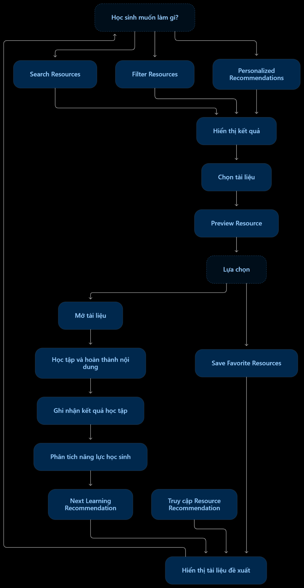

# FEATURE 02: Smart Learning Resource Recommendation – Gợi ý tài liệu học tập thông minh

> **Core Feature**  
> **Personalized Learning**

## 1. Overview – Tổng quan

**Mục đích:**

Cung cấp hệ thống tìm kiếm và đề xuất tài liệu học tập phù hợp với nhu cầu, trình độ và mục tiêu học tập của từng học sinh. Hệ thống kết hợp tìm kiếm tài liệu, lọc theo tiêu chí và phân tích kết quả học tập để đưa ra những nội dung học tập phù hợp.

**Vấn đề cần giải quyết:**

- Học sinh mất nhiều thời gian tìm kiếm tài liệu từ nhiều nguồn khác nhau.
- Có quá nhiều tài liệu nhưng không biết lựa chọn tài liệu phù hợp với trình độ.
- Học sinh thường tìm tài liệu theo sở thích mà chưa chú ý đến những kiến thức mình còn yếu.
- Học sinh không biết nên học nội dung nào tiếp theo sau khi hoàn thành một bài học hoặc bài kiểm tra.

**Đối tượng sử dụng:**

- Học sinh trung học cơ sở.
- Học sinh trung học phổ thông.

**Giá trị mang lại:**

- Giúp học sinh nhanh chóng tìm được tài liệu cần thiết.
- Đề xuất tài liệu phù hợp với năng lực và nhu cầu của từng học sinh.
- Hỗ trợ học sinh lựa chọn nội dung có độ khó phù hợp.
- Định hướng nội dung học tiếp theo dựa trên kết quả học tập.
- Giúp học sinh duy trì lộ trình học tập liên tục và cải thiện kết quả học tập.

## 2. Sub-features – Các chức năng nhỏ

Dựa trên file chi tiết của nhóm, tính năng Smart Learning Resource Recommendation gồm 6 chức năng nhỏ:

| ID | Sub-feature | Mô tả |
| --- | --- | --- |
| SLR-01 | Search Resources | Tìm kiếm tài liệu học tập |
| SLR-02 | Filter Resources | Lọc tài liệu theo tiêu chí |
| SLR-03 | Personalized Recommendations | Gợi ý tài liệu cá nhân hóa |
| SLR-04 | Difficulty Classification | Phân loại độ khó của tài liệu |
| SLR-05 | Preview Resource | Xem trước tài liệu |
| SLR-06 | Save Favorite Resources | Lưu tài liệu yêu thích |
| SLR-07 | Next Learning Recommendation | Gợi ý nội dung học tiếp theo |

## 3. User Flow – Luồng hoạt động

**Luồng tổng quát:**

1. Học sinh truy cập tính năng Smart Learning Resource Recommendation.
2. Hệ thống hiển thị danh sách tài liệu được đề xuất dựa trên thông tin học tập của học sinh.
3. Học sinh có thể:
   - Tìm kiếm tài liệu theo môn học, chủ đề hoặc từ khóa.
   - Lọc tài liệu theo cấp học, môn học, chủ đề, loại tài liệu và độ khó.
   - Xem các tài liệu được cá nhân hóa.
4. Hệ thống hiển thị danh sách tài liệu phù hợp với tiêu chí.
5. Học sinh lựa chọn một tài liệu để xem thông tin chi tiết hoặc xem trước.
6. Học sinh quyết định mở tài liệu hoặc lưu vào danh sách yêu thích.
7. Sau khi học sinh hoàn thành tài liệu, bài học hoặc bài kiểm tra, hệ thống ghi nhận kết quả.
8. Hệ thống phân tích kết quả học tập và đề xuất nội dung học tiếp theo.
9. Các đề xuất được cập nhật khi có kết quả học tập mới.

**Sơ đồ User Flow:**

## 4. Functional Description – Mô tả chức năng

### SLR-01: Search Resources – Tìm kiếm tài liệu

**Mô tả:**

Cho phép học sinh tìm kiếm tài liệu bằng cách nhập tên môn học, chủ đề hoặc từ khóa muốn tìm. Hệ thống tìm kiếm trong kho tài liệu Study Pulse và hiển thị các kết quả liên quan như bài giảng, video và bài tập.

**Input:**

- Tên môn học.
- Chủ đề học tập.
- Từ khóa tìm kiếm.

**Processing:**

1. Học sinh nhập từ khóa tìm kiếm.
2. Hệ thống tiếp nhận và kiểm tra nội dung tìm kiếm.
3. Backend thực hiện tìm kiếm trong kho tài liệu Study Pulse.
4. Hệ thống đối chiếu từ khóa với thông tin tài liệu.
5. Lọc ra những tài liệu có nội dung liên quan.
6. Trả kết quả tìm kiếm về giao diện.

**Output:**

- Danh sách tài liệu liên quan.
- Thông tin tài liệu như tên, mô tả, môn học, chủ đề và loại tài liệu.

**Business Rules:**

- Học sinh phải nhập từ khóa trước khi tìm kiếm.
- Kết quả phải liên quan đến nội dung tìm kiếm.
- Chỉ hiển thị những tài liệu có trong kho tài liệu Study Pulse.

**Exception Handling:**

- Từ khóa bị bỏ trống → yêu cầu nhập nội dung tìm kiếm.
- Không tìm thấy tài liệu phù hợp → hiển thị thông báo không có kết quả.
- Lỗi truy xuất kho tài liệu → thông báo và cho phép thử lại.

### SLR-02: Filter Resources – Lọc tài liệu

**Mô tả:**

Cho phép học sinh lọc tài liệu theo cấp học, môn học, chủ đề và loại tài liệu. Ngoài ra, học sinh có thể lựa chọn mức độ khó gồm Cơ bản, Trung bình hoặc Nâng cao. Hệ thống cập nhật danh sách tài liệu theo các tiêu chí đã chọn.

**Input:**

- Cấp học.
- Môn học.
- Chủ đề.
- Loại tài liệu.
- Mức độ khó: Cơ bản, Trung bình, Nâng cao.

**Processing:**

1. Học sinh lựa chọn các tiêu chí lọc.
2. Hệ thống tiếp nhận các tiêu chí.
3. Backend đối chiếu tiêu chí với thông tin tài liệu trong kho.
4. Lọc các tài liệu thỏa mãn điều kiện.
5. Cập nhật danh sách kết quả trên giao diện.

**Output:**

- Danh sách tài liệu phù hợp với các tiêu chí đã chọn.

**Business Rules:**

- Học sinh có thể chọn một hoặc nhiều tiêu chí lọc.
- Mức độ khó chỉ bao gồm ba lựa chọn: Cơ bản, Trung bình và Nâng cao.
- Kết quả phải được cập nhật theo các tiêu chí hiện tại.
- Khi không chọn tiêu chí, hệ thống hiển thị danh sách tài liệu mặc định.

**Exception Handling:**

- Không có tài liệu phù hợp → thông báo không tìm thấy kết quả.
- Tiêu chí lọc không hợp lệ → yêu cầu lựa chọn lại.
- Lỗi cập nhật kết quả → thông báo và cho phép thử lại.

### SLR-03: Personalized Recommendations – Gợi ý tài liệu cá nhân hóa

**Mô tả:**

Hệ thống thu thập thông tin học tập của học sinh, bao gồm cấp học, mục tiêu học tập, lịch sử học và kết quả quiz. Dựa trên những thông tin này, hệ thống xác định các môn học hoặc chủ đề học sinh cần cải thiện, sau đó so sánh với dữ liệu tài liệu trong hệ thống để lựa chọn nội dung phù hợp.

**Input:**

- Cấp học của học sinh.
- Mục tiêu học tập.
- Lịch sử học tập.
- Kết quả các bài quiz.
- Thông tin về tài liệu trong hệ thống.

**Processing:**

1. Hệ thống thu thập thông tin học tập của học sinh.
2. Phân tích lịch sử học tập và kết quả quiz.
3. Xác định những môn học hoặc chủ đề học sinh cần cải thiện.
4. So sánh nhu cầu học tập với dữ liệu tài liệu trong hệ thống.
5. Lựa chọn những tài liệu phù hợp với năng lực và nhu cầu.
6. Sắp xếp và hiển thị danh sách tài liệu được đề xuất.

**Output:**

- Danh sách tài liệu được đề xuất riêng cho từng học sinh.
- Thông tin tài liệu và mức độ khó tương ứng.

**Business Rules:**

- Đề xuất phải dựa trên thông tin học tập của từng học sinh.
- Ưu tiên những chủ đề học sinh cần cải thiện.
- Tài liệu đề xuất phải phù hợp với cấp học và nhu cầu học tập.
- Không sử dụng cùng một danh sách đề xuất mặc định cho tất cả học sinh.

**Exception Handling:**

- Chưa có lịch sử học tập → sử dụng thông tin cấp học và mục tiêu học tập để đề xuất ban đầu.
- Không có tài liệu phù hợp → thông báo chưa tìm thấy tài liệu phù hợp.
- Không thể phân tích dữ liệu → hiển thị thông báo và cho phép thử lại.

### SLR-04: Difficulty Classification – Phân loại độ khó

**Mô tả:**

Hệ thống phân loại tài liệu theo ba mức độ: Cơ bản, Trung bình và Nâng cao. Mức độ khó được xác định dựa trên thông tin do người quản trị hoặc người biên tập tài liệu cung cấp. Đối với những tài liệu chưa được phân loại, AI có thể hỗ trợ phân tích nội dung để đề xuất mức độ khó.

**Input:**

- Nội dung tài liệu.
- Thông tin độ khó do quản trị viên hoặc người biên tập cung cấp (nếu có).

**Processing:**

1. Hệ thống kiểm tra thông tin phân loại của tài liệu.
2. Nếu tài liệu đã có mức độ khó, hệ thống sử dụng thông tin được cung cấp.
3. Nếu chưa có mức độ khó, AI phân tích nội dung tài liệu.
4. AI đề xuất mức độ: Cơ bản, Trung bình hoặc Nâng cao.
5. Hệ thống hiển thị mức độ khó trên thông tin tài liệu.

**Output:**

- Mức độ khó của tài liệu.
- Nhãn phân loại: Cơ bản, Trung bình hoặc Nâng cao.

**Business Rules:**

- Mỗi tài liệu chỉ được gắn một mức độ khó tại một thời điểm.
- Ưu tiên sử dụng thông tin phân loại do quản trị viên hoặc người biên tập cung cấp.
- AI chỉ hỗ trợ đề xuất mức độ khó đối với tài liệu chưa được phân loại.
- Học sinh có thể lựa chọn tài liệu theo mức độ phù hợp với khả năng.

**Exception Handling:**

- Tài liệu chưa có thông tin phân loại và AI không thể phân tích → hiển thị trạng thái chưa phân loại.
- Nội dung tài liệu không đầy đủ → không đề xuất mức độ khó.
- AI gặp lỗi → thông báo và chờ xử lý lại.

### SLR-05: Preview Resource – Xem trước tài liệu

**Mô tả:**

Cho phép học sinh xem thông tin chi tiết và một phần nội dung tài liệu trước khi quyết định sử dụng. Đối với tài liệu hỗ trợ xem trước, hệ thống hiển thị một phần nội dung. Đối với video, hệ thống hiển thị hình ảnh đại diện và mô tả.

**Input:**

- Tài liệu được học sinh lựa chọn.
- Thông tin mô tả tài liệu.
- Nội dung xem trước (nếu được hỗ trợ).

**Processing:**

1. Học sinh lựa chọn tài liệu muốn xem.
2. Hệ thống truy xuất thông tin tài liệu.
3. Hiển thị tên tài liệu, mô tả, môn học, chủ đề, độ khó và nguồn cung cấp.
4. Kiểm tra khả năng hỗ trợ xem trước.
5. Nếu được hỗ trợ, hiển thị một phần nội dung tài liệu.
6. Nếu là video, hiển thị hình ảnh đại diện và mô tả.

**Output:**

- Thông tin chi tiết về tài liệu.
- Một phần nội dung xem trước hoặc hình ảnh đại diện video.

**Business Rules:**

- Chỉ hiển thị nội dung xem trước đối với tài liệu hỗ trợ chức năng này.
- Thông tin hiển thị phải tương ứng với tài liệu được lựa chọn.
- Không hiển thị toàn bộ nội dung nếu chỉ được phép xem trước một phần.

**Exception Handling:**

- Không truy xuất được tài liệu → thông báo tài liệu không khả dụng.
- Không có nội dung xem trước → hiển thị thông tin mô tả và thông báo không hỗ trợ xem trước.
- Video không có hình ảnh đại diện → hiển thị hình ảnh mặc định.

### SLR-06: Save Favorite Resources – Lưu tài liệu yêu thích

**Mô tả:**

Cho phép học sinh lưu những tài liệu hữu ích vào danh sách yêu thích để dễ dàng truy cập lại. Hệ thống lưu thông tin tài liệu theo tài khoản người dùng. Học sinh có thể xem lại, mở hoặc xóa tài liệu khỏi danh sách đã lưu.

**Input:**

- Tài liệu được học sinh lựa chọn.
- Tài khoản người dùng hiện tại.
- Thao tác lưu, mở hoặc xóa tài liệu.

**Processing:**

1. Học sinh nhấn nút lưu tài liệu.
2. Hệ thống kiểm tra tài liệu đã tồn tại trong danh sách yêu thích chưa.
3. Nếu chưa tồn tại, hệ thống lưu tài liệu theo tài khoản người dùng.
4. Khi học sinh truy cập danh sách yêu thích, hệ thống truy xuất các tài liệu đã lưu.
5. Học sinh có thể mở hoặc xóa tài liệu.

**Output:**

- Danh sách tài liệu yêu thích của học sinh.
- Thông báo lưu thành công hoặc xóa thành công.

**Business Rules:**

- Tài liệu được lưu theo tài khoản người dùng.
- Không lưu trùng một tài liệu trong cùng danh sách yêu thích.
- Học sinh chỉ được quản lý danh sách yêu thích của tài khoản mình.
- Khi xóa, tài liệu chỉ bị xóa khỏi danh sách yêu thích, không xóa tài liệu gốc.

**Exception Handling:**

- Người dùng chưa đăng nhập → yêu cầu đăng nhập.
- Tài liệu đã được lưu → thông báo tài liệu đã tồn tại.
- Lưu thất bại → thông báo và cho phép thử lại.
- Tài liệu không còn khả dụng → thông báo tài liệu không thể mở.

### SLR-07: Next Learning Recommendation – Gợi ý nội dung học tiếp theo

**Mô tả:**

Sau khi học sinh hoàn thành một tài liệu, bài học hoặc bài kiểm tra, hệ thống ghi nhận kết quả học tập và phân tích mức độ hiểu kiến thức. Nếu học sinh thường xuyên mắc lỗi ở một chủ đề, hệ thống đề xuất tài liệu cơ bản hoặc bài tập bổ trợ. Nếu học sinh đã nắm vững kiến thức, hệ thống đề xuất nội dung tiếp theo hoặc tài liệu có độ khó cao hơn.

**Input:**

- Kết quả bài quiz.
- Lịch sử học tập.
- Trạng thái hoàn thành tài liệu hoặc bài học.
- Thông tin về chủ đề và mức độ khó của tài liệu.

**Processing:**

1. Hệ thống ghi nhận kết quả sau khi học sinh hoàn thành tài liệu, bài học hoặc bài kiểm tra.
2. Phân tích kết quả học tập và xác định những chủ đề học sinh thường mắc lỗi.
3. Nếu học sinh chưa nắm vững kiến thức, hệ thống tìm tài liệu cơ bản hoặc bài tập bổ trợ về chủ đề đó.
4. Nếu học sinh đã nắm vững kiến thức, hệ thống tìm nội dung tiếp theo hoặc tài liệu có độ khó cao hơn.
5. Hiển thị đề xuất học tập cho học sinh.
6. Cập nhật đề xuất dựa trên kết quả học tập mới.

**Output:**

- Danh sách tài liệu hoặc bài tập cần ôn tập lại.
- Nội dung học tập tiếp theo.
- Tài liệu có mức độ khó phù hợp với năng lực hiện tại.

**Business Rules:**

- Đề xuất phải dựa trên kết quả học tập thực tế.
- Học sinh thường xuyên mắc lỗi ở chủ đề nào thì ưu tiên đề xuất tài liệu bổ trợ cho chủ đề đó.
- Học sinh đã nắm vững kiến thức có thể được đề xuất nội dung nâng cao hơn.
- Các đề xuất phải được cập nhật khi có kết quả học tập mới.

**Exception Handling:**

- Chưa có kết quả học tập → đề xuất dựa trên cấp học và mục tiêu học tập.
- Không tìm thấy tài liệu bổ trợ → thông báo chưa có tài liệu phù hợp.
- Không ghi nhận được kết quả học tập → không cập nhật đề xuất và thông báo lỗi.
- Lỗi phân tích dữ liệu → sử dụng đề xuất gần nhất nếu có.

## 5. Acceptance Criteria – Tiêu chí nghiệm thu

| ID | Tiêu chí nghiệm thu |
| --- | --- |
| AC-01 | Học sinh có thể tìm kiếm tài liệu bằng tên môn học, chủ đề hoặc từ khóa. |
| AC-02 | Hệ thống hiển thị các tài liệu có liên quan đến nội dung tìm kiếm. |
| AC-03 | Học sinh có thể lọc tài liệu theo cấp học, môn học, chủ đề và loại tài liệu. |
| AC-04 | Học sinh có thể lựa chọn ba mức độ khó: Cơ bản, Trung bình và Nâng cao. |
| AC-05 | Hệ thống đề xuất tài liệu dựa trên thông tin và kết quả học tập của từng học sinh. |
| AC-06 | Hệ thống phân loại được độ khó của tài liệu. |
| AC-07 | Học sinh có thể xem thông tin chi tiết và nội dung xem trước của tài liệu được hỗ trợ. |
| AC-08 | Học sinh có thể lưu tài liệu vào danh sách yêu thích. |
| AC-09 | Học sinh có thể xem lại, mở và xóa tài liệu đã lưu. |
| AC-10 | Hệ thống ghi nhận kết quả sau khi học sinh hoàn thành nội dung học tập. |
| AC-11 | Hệ thống đề xuất tài liệu bổ trợ khi học sinh chưa nắm vững kiến thức. |
| AC-12 | Hệ thống đề xuất nội dung nâng cao khi học sinh đã nắm vững kiến thức. |
| AC-13 | Các đề xuất được cập nhật dựa trên kết quả học tập mới. |

## 6. UI/UX Reference – Giao diện tham khảo

**Mô tả màn hình dự kiến:**

- **Resource Home:** Hiển thị thanh tìm kiếm, danh sách tài liệu và các tài liệu đề xuất.
- **Search Results:** Hiển thị kết quả tìm kiếm theo từ khóa.
- **Filter Resources:** Cung cấp bộ lọc tài liệu theo tiêu chí.
- **Resource Details:** Hiển thị thông tin và nội dung xem trước.
- **Favorite Resources:** Quản lý danh sách tài liệu yêu thích.
- **Next Learning:** Hiển thị nội dung học tiếp theo dựa trên kết quả học tập.

## 7. Priority – Mức độ ưu tiên

**High**

**Mức độ ưu tiên:** High

Lý do: Tính năng này giúp học sinh tìm được tài liệu phù hợp với trình độ và nhu cầu học tập. Đặc biệt, khả năng đề xuất nội dung dựa trên kết quả học tập giúp Study Pulse định hướng quá trình học tập liên tục, góp phần cải thiện sự tiến bộ của học sinh.
